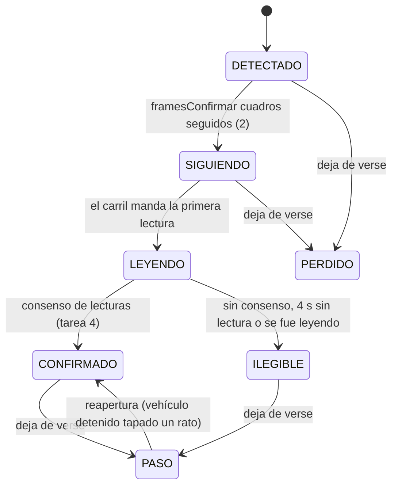
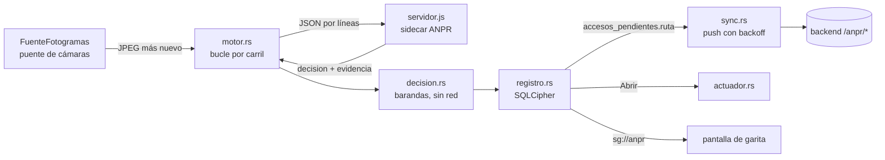

# ANPR continuo (Sprint 10)

Reconocimiento continuo de placas para una cámara IP fija en el carril. El modo por clic («click-to-capture») sigue existiendo
y es el respaldo en todos lados. Este documento se escribió **antes** de programar (exploración y plan) y se completa tarea por
tarea; cada sección dice qué está hecho, qué quedó detrás de bandera y qué falta validar con hardware real.

> **Estado:** en curso. Ver «Estado por tarea» al final.

## 1. Exploración (resumen, sin cambios de código)

| Pieza | Dónde | Lo que importa para ANPR |
|---|---|---|
| `PRODUCT.md` | — | **No existe en el repo** (ya lo decían `docs/saas_nucleo.md` y `docs/sprint9_continuacion.md`). Se crea en la tarea 8 con lo verificable del README y lo nuevo de ANPR. |
| Puente de cámaras | `desktop/src-tauri/src/camaras/` (`docs/camaras_ip_diseno.md`) | `FuenteFotogramas` entrega el **último JPEG en memoria** y su estado; `esperar_fotograma` da el más nuevo sin colas. ffmpeg mínimo LGPL (RTSP→MJPEG 960 px, 10 fps) o proxy MJPEG. Credenciales en el llavero, SSRF validado. ANPR consume esta interfaz: **no abre otra conexión a la cámara**. |
| OCR local | `desktop/sidecar-ocr/src/server.js` | Proceso Node hijo de Tauri, JSON por líneas, `ppu-paddle-ocr` (PP-OCRv5 mobile det + rec «en») sobre `onnxruntime-node` 1.30 (CPU). Atiende en serie; nunca escribe a disco (`privacidad.test.js` lo vigila). Modelos fuera de git, descargados por `scripts/fetch-models.mjs` con SHA-256 fijo. |
| Regex de placa | `desktop/src/lib/placa.ts` | Prefijo 1–3 letras + 3 dígitos + 3 letras; corrección por posición O/0, I/1, B/8…; `correcciones > 0` ⇒ `requiereRevision`. Vive en TypeScript (WebView); el sidecar no la tenía. |
| Ciclo de vida del sidecar | `desktop/src-tauri/src/ocr.rs` | `asegurar_arrancado` lanza `node server.js --models …`, espera `{"evento":"listo"}`, correlaciona respuestas por `id`, 20 s de tope por inferencia. |
| Base local | `desktop/src-tauri/src/db.rs` | SQLCipher (AES-256, clave Argon2id de huella + licencia). Espejo: `residentes_local`, `blacklist_local` (DPI o placa), `preautorizaciones_local`, `invitaciones_qr_local`; cola `accesos_pendientes` (payload exacto del POST, `id_cliente` UUID). Migraciones idempotentes por columna. |
| Cola offline | `desktop/src-tauri/src/sync.rs` | Push cada 30 s con backoff 5 s→10 min; 2xx = sincronizado, 4xx de negocio = rechazado (visible), red/sesión = detener. Pull completo de `GET /sync/garita` cada 5 min. |
| Talanquera | `desktop/src-tauri/src/hardware/` | Trait `TalanqueraDriver` (relé USB, Ethernet TCP/HTTP, GPIO stub). Regla: un fallo de apertura **nunca** revierte un acceso registrado. |
| Snapshot | `backend/src/controllers/sync.controller.ts` | Doble llave (JWT de agente + licencia del equipo, misma sucursal). Pull completo, sin versionado. Empresa suspendida ⇒ 423 desde `verifyLicencia`. |
| `registros_acceso` | `database/init.sql` | `visitante_id NOT NULL` (todo acceso era de un visitante); `origen IN ('web','desktop')`; `id_cliente` único = idempotencia. Migraciones en el mismo `init.sql`, idempotentes (`DO $$ … EXCEPTION`). **No existe una tabla de vehículos de residentes** (`vehiculos` cuelga de `visitantes`). |
| Auditoría | `backend/src/middleware/audit.middleware.ts` | `auditLog({accion})` escribe al terminar con el código HTTP; detalle en `res.locals.auditoria`. Toda acción nueva va en `docs/acciones_sensibles.md` y en las traducciones de la web (lo vigilan `auditoria.cobertura.test.ts` y `auditoria.test.ts`). |
| Configuración por equipo | `desktop/src/lib/camaras.ts`, `ThemeContext.tsx`, `config_hardware` | Tema y disposición de cámaras en `localStorage` del WebView (del puesto, no del agente); talanquera y cámaras IP en SQLCipher (del equipo). |

Línea base antes de tocar nada (22/10/2026, este contenedor): backend unitarias 834/834; integración 426/427 (un fallo
intermitente en `contacto.int.test.ts` que no se repite al reintentar, preexistente); escritorio Vitest 168/168; frontend
576/576; `cargo test --lib` 205 (2 ignoradas); sidecar `node --test` 37 (1 omitida: necesita mediamtx).

## 2. Decisiones de arquitectura

1. **Proceso aparte para ANPR** (`sidecar-ocr/src/anpr/servidor.js`, mismo runtime Node empaquetado). El OCR por clic sigue en su
   proceso y con su cola: ANPR no le roba turnos ni puede tumbarlo. «Pausar ANPR» mata solo este proceso. Coste: RAM de un
   segundo motor de OCR (se mide en la tarea 7).
2. **Los fotogramas los entrega Rust** desde `FuenteFotogramas` (JPEG en base64 por stdin). El sidecar contesta con el fps que
   quiere (1 fps en reposo, 5 fps con movimiento) y Rust lo respeta: en reposo no se decodifica nada de más.
3. **Detector: YOLOX-Nano** (Megvii, **Apache-2.0**), ONNX oficial 416×416. Ultralytics YOLOv5/v8/v11 son AGPL-3.0 y
   YOLOv6/v7/v9 GPL-3.0: descartados por licencia. Clases COCO útiles: `car`→carro, `motorcycle`→moto, `bus`→bus,
   `truck`→camión. COCO no separa «camioneta»: una pickup sale como `car` o `truck`; la clase es informativa y no cambia la decisión.
4. **Regex de placa en el sidecar**: copia en JS de `desktop/src/lib/placa.ts`, con una prueba de paridad en Vitest que compara
   ambas sobre el mismo corpus (si una cambia sin la otra, falla).
5. **La decisión es de Rust** contra el espejo SQLCipher: funciona sin internet y reusa la cola `accesos_pendientes`.
6. **Evidencia** (recorte de placa y de la parte baja del vehículo, JPEG): el sidecar la devuelve en memoria, Rust la guarda
   **cifrada en SQLCipher** y la purga a los 7 días; se sube al backend después de sincronizar el acceso. El sidecar sigue sin
   escribir a disco.
7. **Modelo de datos**: tabla nueva `vehiculos_residentes` (placa normalizada, vigencia, versión para sincronizar cambios);
   `registros_acceso.visitante_id` pasa a admitir NULL **solo** cuando el acceso es de un vehículo de residente (CHECK).
8. **Configuración por carril** en SQLCipher (`carriles_anpr`, del equipo como la talanquera y las cámaras), con la bandera
   global «Pausar ANPR» en `meta`. Carril nuevo: `apagado`; al habilitarlo el modo por defecto es `automatico` (decisión del equipo).
9. **Actuador**: trait `ActuadorBarrera` con `Simulado` (registro + señal en la UI), `ReleHttp` (URL, método, timeout, un solo
   reintento; solo direcciones privadas, mismo validador SSRF que las cámaras) y un adaptador a la talanquera ya configurada.
   Un fallo del actuador es una alerta, nunca deshace el registro.

## 3. Barandas (sección 0 del sprint)

Se auto-autoriza **solo si todo** se cumple: placa en `vehiculos_autorizados_local` activa y vigente hoy, residente activo en el
espejo, fuera de lista negra, licencia utilizable (empresa no suspendida), consenso alcanzado y **ninguna** corrección por
posición en las lecturas ganadoras. Lista negra ⇒ alerta visible y sonora, nunca abre. Desconocida, ilegible o corregida ⇒
verificación del agente con la evidencia. Un evento por pista; 60 s de enfriamiento por placa. Modo por carril
`apagado | verificacion | automatico`.

## 4. Plan por tarea

| # | Entregable | Pruebas |
|---|---|---|
| 1 | `anpr/reloj.js`, `anpr/roi.js`, `anpr/movimiento.js`: diferencia de grises suavizada dentro del ROI, histéresis, fps de reposo | `node --test` con fotogramas sintéticos y reloj falso |
| 2 | `anpr/detector.js` (letterbox, decodificación YOLOX, NMS, filtro ROI), `fetch-models.mjs` con YOLOX-Nano y SHA-256, `test-fixtures/anpr/` | post-proceso con tensores fijos; detección real sobre los clips (se omite sin modelos) |
| 3 | `anpr/tracker.js`: IoU + centroide, pérdida tolerada, máquina de estados, una decisión por pista, enfriamiento | trayectorias sintéticas (a)–(e) |
| 4 | `anpr/consenso.js`, `anpr/placa.js`, `anpr/evidencia.js`, `anpr/carril.js`, `anpr/servidor.js` | lecturas simuladas; regresión del OCR por clic |
| 5 | Migración + `vehiculos_residentes` + `/sync/garita` versionado + `POST /accesos/anpr*`; Rust `anpr/` (decisión, actuador, eventos, motor) | Jest unitarias + integración (Postgres); `cargo test` de cada rama |
| 6 | Panel ANPR en la garita, lista de eventos, «Corregir», alertas, configuración por carril con ROI dibujable, «Pausar ANPR» | Vitest/RTL, accesibilidad básica |
| 7 | `desktop/scripts/medir-anpr.mjs` | reporte reproducible |
| 8 | E2E con clip de ffmpeg, CI, documentación final | — |

## 5. Tarea 1 — Movimiento y ROI por carril

Código: `desktop/sidecar-ocr/src/anpr/{reloj,roi,movimiento,imagen}.js`. Pruebas: `movimiento.test.js` (fotogramas sintéticos
de 160×90 con ruido determinista y `RelojFalso`).

- **ROI**: polígono normalizado (0–1), de 3 a 32 vértices; sin ROI = todo el cuadro. Un ROI mal escrito es un error, no «todo el
  cuadro» en silencio. `fraccionDentro(caja)` (rejilla de 5×5) lo usa el detector de vehículos para descartar el carril de al lado.
- **Movimiento**: el cuadro se reduce a 160 px de ancho en gris, se suaviza (caja 3×3) y se resta del anterior **solo dentro
  del ROI**, descontando la diferencia media (un cambio de exposición o una nube no es movimiento). `cambio` = fracción de píxeles
  del ROI con diferencia > `umbralPixel` (18).
- **Histéresis** por cuadros: `framesActivar` = 3 (al restar cuadros, un destello de UN cuadro produce DOS diferencias; con 2 se
  colaba), `framesDesactivar` = 6 (~1,2 s a 5 fps).
- **Ritmo**: 1 fps en reposo y 5 fps con movimiento; el primer cuadro sospechoso ya pide 5 fps para confirmar en ~0,4 s en vez
  de 3 s. `Ritmo` descarta los cuadros que llegan antes de tiempo. Quien entrega los cuadros (Rust) respeta el fps pedido.
- **Salida**: `movimiento_inicio` / `movimiento_fin` (con `duracion_ms`) con la hora del reloj inyectado.
- Costo medido en la prueba: < 1 ms por cuadro de 160×90 en este Xeon (tope de la prueba: 15 ms, para runners lentos).

Límite conocido: restar cuadros no ve un vehículo **detenido**. Por eso el carril (tarea 4) mantiene despierto el detector
mientras haya una pista sin decidir, aunque el movimiento haya terminado.

## 6. Tarea 2 — Detector de vehículos (YOLOX-Nano)

Código: `desktop/sidecar-ocr/src/anpr/detector.js` (+ `clip.js`, lector de clips para pruebas y medición). Modelo:
`yolox_nano.onnx` (3,5 MB) descargado por `sidecar-ocr/scripts/fetch-models.mjs` desde el release oficial con SHA-256 fijo
`c789161e…18a0b7d`; **no va a git** (la carpeta `models/` sigue ignorada). `prepare-sidecar.mjs` ahora corre siempre
`fetch-models.mjs` (es idempotente) para que una carpeta de modelos anterior al Sprint 10 se complete sola.

**Licencia**: YOLOX (código y pesos publicados en sus releases) es **Apache-2.0**, © Megvii Inc.
(<https://github.com/Megvii-BaseDetection/YOLOX/blob/main/LICENSE>). Permite uso comercial y redistribución con el aviso de
licencia: el instalador debe incluir el texto de Apache-2.0 junto a los modelos (pendiente de sumar al aviso de terceros del
instalador, igual que la licencia LGPL de ffmpeg). Los pesos se entrenaron con COCO (anotaciones CC BY 4.0). Se descartaron
Ultralytics YOLOv5/v8/YOLO11 (AGPL-3.0), YOLOv6/v7/v9 (GPL-3.0) y YOLOv10 (AGPL-3.0). *No es asesoría legal.*

- Pre-proceso de YOLOX: letterbox 416×416 **arriba a la izquierda**, relleno 114, BGR, sin normalizar.
- Post-proceso: decodificación de las rejillas 8/16/32, puntaje = objetualidad × mejor clase de vehículo, NMS **sin distinguir
  clase** (IoU 0,45: una pickup vista como `car` y `truck` es un solo vehículo), umbral 0,35, y filtro por ROI (≥ 30 % de la caja
  dentro, rejilla de 5×5). Clases: `car`→`carro`, `motorcycle`→`moto`, `bus`→`bus`, `truck`→`camion`.
- Salida por fotograma: `{cajas: [{clase, confianza, bbox, en_roi}], descartadas, ms}`.

**Fixtures** (`test-fixtures/anpr/`, ver su README): dos fotos CC0 de Wikimedia Commons (placa en blanco de origen) y todo lo
demás sintético; 7 clips de 960×540 a 10 fps (5,3 MB en total). Un vehículo dibujado solo por código **no sirve**: YOLOX lo
clasificó como avión (`airplane`), por eso se usan fotos reales con licencia libre.

**Medido** (este contenedor: Xeon 2,8 GHz, 4 vCPU, Linux; clip `entrada_p123abc` a 5 fps, incluye letterbox y post-proceso):

| Hilos de ONNX | Mediana | p95 |
|---|---|---|
| 1 | 34,7 ms | 50,7 ms |
| 2 (por defecto) | 24,3 ms | 33,6 ms |
| 4 | 21,7 ms | 38,7 ms |

A 5 fps con movimiento son ~12–17 % de un núcleo; en reposo el detector no corre. Sin vehículo en el ROI (`vacio`,
`carril_vecino`) no hay ninguna detección aceptada; con el vehículo en el ROI se detecta en todos los cuadros en que está
completo (`00000111…11100000`), siempre una sola caja.

## 7. Tarea 3 — Seguimiento (tracker) y máquina de estados

Código: `desktop/sidecar-ocr/src/anpr/tracker.js`. Pruebas: `tracker.test.js` (trayectorias sintéticas, `RelojFalso`).

- **Asociación**: IoU (≥ 0,2, el mayor primero) y, para lo que quede, distancia de centroides (≤ 12 % de la diagonal); en los dos
  casos con tamaño parecido (área entre ½ y 2×: una moto no se pega a la pista de un bus, ni una pista vieja al vehículo siguiente).
- **Pérdida tolerada**: 8 cuadros (~1,6 s a 5 fps) **o** 2 s sin verla, lo que pase primero (oclusión corta = misma pista); si
  la última vez tocaba el borde del cuadro (salió), 2 cuadros. Ver el fallo corregido en la tarea 4.
- **Reapertura**: durante 5 s una detección en el mismo lugar reabre la pista con su mismo id y su decisión. **Solo** si la
  pista estaba casi quieta (≤ 1 % de la diagonal por cuadro) y lejos del borde: la de un vehículo que se iba no se reabre, para
  que el siguiente que llega al mismo punto no herede su decisión (prueba «(c′)»).
- **Una decisión por pista** (`decidida`). Si una pista que se estaba leyendo se va sin consenso, se emite `ilegible` con
  motivo `se_fue_sin_lectura`: el agente se entera de que pasó un vehículo sin placa leída.
- **Enfriamiento de 60 s por placa**, contado desde la ÚLTIMA vez que se vio el vehículo con esa placa (no desde la
  confirmación): un carro estacionado que se re-detecta tras perderse no genera otro evento.
- **Tiempo máximo de lectura**: 4 s (configurable) desde que la pista pasa a LEYENDO → ILEGIBLE.
- Todos los tiempos salen del reloj inyectado; los eventos de transición se entregan en orden por `actualizar()` /
  `tomarEventos()`.

Aceptación cubierta: (a) un carro cruzando = un evento; (b) detenido 2 min (con pérdidas cortas) = un evento, y (b′) tapado
más que la tolerancia = reapertura sin segundo evento; (c) dos carros seguidos = dos pistas y dos eventos, y (c′) el segundo
no hereda la pista del primero; (d) oclusión corta no parte la pista; (e) la misma placa dentro de 60 s se ignora y después
no.

## 8. Tarea 4 — Consenso de lecturas y evidencia

Código (sidecar): `anpr/consenso.js`, `anpr/placa.js` (+ `placa.d.ts`), `anpr/evidencia.js`, `anpr/carril.js` (une todo por
cámara) y `anpr/servidor.js` (el proceso ANPR). Pruebas: `consenso.test.js`, `carril.test.js` (detector, OCR y reloj falsos
sobre JPEG sintéticos), `servidor.test.js` (incluye la corrida real con los clips), `ocr-clic.regresion.test.js` y, en el
escritorio, `src/lib/__tests__/placa.paridad.test.ts`.

**Calidad del recorte** (0–1): 45 % tamaño del vehículo en el cuadro, 40 % nitidez (varianza del Laplaciano de la parte baja
del vehículo, en escala log), 15 % posición (centrado). Una caja que toca el borde vale 0 (la placa puede estar cortada). Por
pista se guardan los 5 mejores recortes y se lee como mucho **uno por cuadro**, siempre el mejor pendiente; recortes con calidad
< 0,25 no gastan OCR. La pista pasa a LEYENDO —y empieza a contar su tiempo máximo de 4 s— con el **primer recorte útil**: un
vehículo que entra tocando el borde no gasta ese tiempo esperando. Un vehículo seguido varios cuadros del que nunca hubo un
recorte útil también avisa al agente (`ilegible`, motivo `sin_recorte_util`).

**Lectura**: el MISMO OCR de la captura por clic (`server.js::recognize`, PP-OCRv5) sobre la parte baja del vehículo (desde el
30 % de su altura, con un 12 % de margen a cada lado: la caja de YOLOX se queda corta en una vista de tres cuartos y dejaba la
placa en el borde); su detector de texto ubica la placa. Cuando una lectura ya ubicó la placa, las siguientes recortan alrededor
de ella (±60 %, ampliado a ≥ 240 px de ancho si queda más chico): en `dos_seguidos` la primera lectura tardó 160–230 ms y las
siguientes 50–165 ms. Si la relectura no encuentra la placa donde se esperaba, la siguiente vuelve a la parte baja completa. Después, la regex
guatemalteca (`placa.js`, copia de `lib/placa.ts`; la prueba de paridad compara las dos sobre 32 textos y 6 juegos de fragmentos).

**Consenso** (configurable):

- confirma cuando **≥ 3** lecturas válidas dan la misma placa **y** la confianza agregada **≥ 0,90**;
- confianza agregada = media de la confianza del OCR en las lecturas que coinciden × fracción de lecturas válidas que coinciden.
  Es conservadora a propósito: con el umbral por defecto una sola lectura **válida** discrepante entre 4–5 impide confirmar
  (ante la duda, verificación del agente). Las lecturas sin forma de placa no votan, ni las que tienen forma de placa pero
  confianza del OCR **< 0,75** (`confianzaVoto`): el propio OCR no las cree. Caso real con el equipo muy cargado: `P555TRK` a
  0,93 y después «E055STR» a 0,57; antes esa lectura débil volvía inalcanzable el 0,90 y la pista salía ilegible a la segunda
  lectura;
- dos cupos: **5 lecturas válidas** y **8 intentos** en total. Una lectura sin forma de placa (recorte movido, «GUATEMALA» pegado
  al texto) no es evidencia de OTRA placa: no gasta el cupo de válidas, sí el de intentos;
- se declara **ilegible** en cuanto ni con todas las lecturas restantes perfectas se llegaría (cota optimista), o al agotar un cupo;
- **corrección por posición**: si el consenso **necesita** alguna lectura corregida (menos de 3 lecturas literales en el grupo
  ganador) o el prefijo no es conocido → `requiere_verificacion = true` (nunca abre solo). Tres lecturas literales más una
  corregida que coincide no la necesitan. `alguna_correccion` registra si cualquier lectura se corrigió;
- **una lectura literal más antes de rendirse**: si el consenso ya alcanzaría pero solo gracias a una corrección, y el cupo da
  para las literales que faltan, la pista sigue leyendo (`pendiente`, `confirmable`). Si llega la literal, confirma sin
  verificación; si se agota el cupo, el tiempo de lectura o el vehículo se va, sale **confirmada con verificación** (el tracker
  lo cierra CONFIRMADO vía `alCerrarLectura` y entra al enfriamiento). Con el equipo cargado se leen menos cuadros y la corrida
  real a veces cerraba con 2 literales + 1 corregida: ahora espera una más.

**Evidencia**: recorte de la placa (con 20 % de margen, JPEG calidad 85) y de la **parte baja** del vehículo (desde el 45 % de
la altura de su caja: deja fuera parabrisas, medallón y cabina, donde podría verse una cara; máximo 480 px de ancho, calidad
70), del mejor cuadro leído. Viajan en base64 dentro de la decisión hacia Rust, que los guarda cifrados; `expira_ms` = hora de
la decisión + 7 días (la purga la hace Rust, tarea 5). El sidecar sigue sin escribir a disco (la guarda de privacidad cubre
`src/anpr/`). Es una regla geométrica, no un detector de caras: hay que validarla con el encuadre de la cámara real.

**El carril** (`carril.js`): ritmo (1 fps en reposo), movimiento, detector solo con movimiento o con pistas sin decidir, y en
«vigilancia» (pistas ya decididas, sin movimiento) a 1 fps hasta que terminen. Devuelve por cuadro los eventos (`movimiento_*`,
`pista`, `decision`, `ignorada`), las pistas para la superposición y los ms por etapa (`decodificar`, `movimiento`, `detector`,
`tracker`, `ocr`), que usa la medición de la tarea 7.

**Decisión** (lo que recibe Rust): `{tipo: 'decision', carril, track_id, resultado: 'confirmada'|'ilegible', placa,
placa_probable, confianza, votos, lecturas[], requiere_verificacion, alguna_correccion, motivo, clase, ts, ms_desde_legible,
evidencia: {placa_jpeg, vehiculo_jpeg, expira_ms}}`. Ilegible siempre lleva `requiere_verificacion = true` y `placa = null`.

**El OCR por clic no cambia**: `server.js` no se tocó (el ANPR corre en `servidor.js`, otro proceso que solo *importa* su
`recognize`), y `ocr-clic.regresion.test.js` fija por el protocolo real lo que devuelve hoy sobre `test-assets/` (texto exacto
por fragmento, confianza ±0,02). La suite del clic (Vitest de `lib/placa.ts`, DPI, cámara) sigue en verde.

**Corrida real** (proceso ANPR aparte, YOLOX-Nano + OCR, clips reproducidos en tiempo real como los entrega el puente; este
contenedor):

| Clip | Resultado | ms desde la primera lectura legible |
|---|---|---|
| `entrada_p123abc` | confirmada `P123ABC` | 368 |
| `dos_seguidos` | confirmada `P555TRK`, confirmada `U318BCD` | 333 / 384 |
| `ilegible` | ilegible → verificación del agente | — |
| `vacio`, `carril_vecino` | ninguna decisión, ni siquiera despierta | — |

**Robustez bajo carga.** Con la suite del sidecar corriendo en paralelo (CPU saturada) el clip `dos_seguidos` terminaba en
ilegible: la placa del sedán negro quedaba en el borde del recorte (caja de YOLOX corta), las relecturas eran recortes de
~90 px y las lecturas vacías gastaban el cupo. Tras los cuatro ajustes de arriba (margen lateral, ampliar relecturas, cupos
separados, reloj de lectura desde el primer recorte útil) la corrida real pasa 3 de 3 veces con la suite en paralelo y también
con 3 procesos quemando CPU a la vez (latencias de 321 a 1 536 ms desde la primera lectura legible; objetivo < 2 s).

**Fallo encontrado y corregido** durante esta tarea (commit `fix(anpr)` aparte): en `dos_seguidos` el segundo vehículo
**heredaba la pista ya decidida del primero** (la pista vieja seguía viva a 1 fps y se asoció por IoU 0,23 a una caja 2,6 veces
más grande), así que pasaba sin decisión ni aviso. Ahora la asociación exige tamaño parecido también por IoU, una pista termina
por tiempo (2 s sin verla) además de por cuadros, y una que salió por el borde termina a los 2 cuadros.

## 9. Tarea 5 — Decisión, registro `anpr` y actuador

### 9.1 Modelo de datos (backend, `database/init.sql`, idempotente)

| Objeto | Para qué |
|---|---|
| `vehiculos_residentes` | Vehículos **autorizados** de cada residente: placa normalizada (`P123ABC`, CHECK `^[A-Z0-9]{3,20}$`), vigencia (`vigente_desde`/`vigente_hasta`, DATE), `activo` (una baja nunca es DELETE), `version` de una secuencia. Una placa activa por sucursal (índice único parcial). |
| Disparadores de versión | La versión sube con cada UPDATE de la fila, con cualquier cambio de un bloqueo **por placa** en `visitante_blacklist` de esa sucursal y con la baja/alta del usuario del residente: la garita se entera en el pull incremental. |
| `registros_acceso` | Columnas nuevas `confianza` (0–1), `track_id`, `evidencia_ref` (`anpr:<id_cliente>`), `vehiculo_residente_id`, `verificado_por` (agente que confirmó con un toque) e `id_cliente_salida` (salida idempotente). `visitante_id` admite NULL **solo** si hay `vehiculo_residente_id` (CHECK). `origen` admite `'anpr'`. |
| `anpr_eventos` | Lo que no es un acceso pero va a la bitácora: `alerta_lista_negra`, `verificacion_resuelta`, `ilegible`, `actuador_fallo`. PK = `id_cliente` de la garita (idempotente). |
| `evidencias_anpr` | JPEG de placa y de vehículo (≤ 256 KB, `UNIQUE (id_cliente, tipo)`), `expira_en` a 7 días; los purga la tarea programada `anpr.evidencias`. |

Borrado definitivo de una empresa (`empresas.controller.ts`): se agregaron los pasos para `evidencias_anpr`, `anpr_eventos` y
`vehiculos_residentes`, en el orden que exigen las llaves foráneas.

### 9.2 API (`backend/src/routes/anpr.routes.ts`)

| Ruta | Quién | Notas |
|---|---|---|
| `GET/POST /api/anpr/vehiculos`, `PATCH/DELETE /api/anpr/vehiculos/:id` | admin de sucursal o superior, con `tenantFilter` | Alta valida residente de la misma sucursal, placa plausible y vigencia; DELETE = baja (`activo = FALSE`). Bitácora `VEHICULO_RESIDENTE_*`. |
| `POST /api/anpr/accesos` | agente + licencia del equipo (`verifyLicencia`: empresa suspendida → **423**) | Idempotente por `id_cliente`. El servidor **vuelve a validar** (vehículo activo y vigente el día del registro, residente activo, sin bloqueo por placa): si algo cambió mientras la garita estaba sin red responde 409/403 y la cola lo marca «rechazado», igual que con visitantes. Bitácora `ANPR_ACCESO_AUTOMATICO` o `ANPR_ACCESO_VERIFICADO` según el modo. |
| `POST /api/anpr/salidas` | ídem | Cierra el registro abierto más reciente de ese vehículo; idempotente por `id_cliente_salida`. Sin registro abierto → 404 y la cola lo marca «rechazado» (el agente lo ve en «Registrados en este equipo»). |
| `POST /api/anpr/eventos` | ídem | Alerta de lista negra, verificación resuelta, ilegible, falla del actuador. Bitácora con su acción (`ANPR_ALERTA_LISTA_NEGRA`, …). |
| `POST /api/anpr/evidencias` | ídem | Solo para un acceso o evento **ya recibido** de la misma sucursal; JPEG real (firma `FF D8 FF`), ≤ 256 KB, SHA-256 verificado; reenvío idempotente. La ruta usa el límite de cuerpo mayor de `app.ts` (el mismo del logo); el resto de la API sigue con el chico. |
| `GET /api/anpr/evidencias/:id_cliente/:tipo` | personal de la sucursal | Devuelve el JPEG mientras no caduque. |
| `GET /api/sync/garita?vehiculos_desde=N` | (existente) | Agrega `vehiculos: { modo: completo|cambios, version, filas }`. Sin parámetro o `0` → lista completa de los que hoy pueden entrar; con versión → solo lo que cambió (bajas como `activo: false`). Respeta multi-tenant y 423 como el resto del snapshot. |

Las acciones nuevas están en `docs/acciones_sensibles.md`, en la tabla de auditoría del owner (`frontend/src/pages/owner/auditoria.ts`)
y en la prueba I-11 (`auditoria.int.test.ts`), que exige un caso por acción. La matriz de roles de
`security.routes.contract.test.ts` cubre las 9 rutas nuevas.

### 9.3 Garita (Rust, `desktop/src-tauri/src/anpr/`)

- **Espejo local** (`vehiculos_autorizados_local`): `sync.rs` pide `vehiculos_desde` con la versión guardada y aplica los
  cambios; cada 30 min pide la lista completa (cubre una carrera entre dos cambios casi simultáneos y los residentes eliminados).
- **Decisión** (`decision.rs::decidir`), en este orden: carril apagado → nada; no confirmada por consenso → verificación
  (ilegible); **lista negra → alerta, nunca abre** (antes que todo, también con lectura corregida); misma placa en el carril
  hace < 60 s → se ignora; licencia que no permite operar (suspendida, revocada, gracia vencida) → verificación; lectura con
  corrección por posición → verificación; placa desconocida, vehículo dado de baja, fuera de vigencia o residente que ya no está
  en la copia → verificación; todo en orden → `automatico` abre, `verificacion` espera el toque del agente. Hay una prueba
  exhaustiva que recorre todas las combinaciones y comprueba que **ninguna** abre con lista negra, licencia bloqueada o lectura
  corregida.
- **Registro** (`registro.rs`): cada decisión deja un `anpr_eventos_local` y su evidencia **cifrada en SQLCipher**. Lo que va al
  backend usa la cola de siempre (`accesos_pendientes`) con la columna nueva `ruta` (`/anpr/accesos`, `/anpr/salidas`,
  `/anpr/eventos`; lista blanca en `sync.rs`) y `visible = 0` para que los eventos no aparezcan en «Registrados en este equipo».
  El `id_cliente` es el de la fila: los reintentos sin red no duplican. La evidencia sube **después** de que su acceso o evento
  quedó sincronizado (`push_evidencias`, con SHA-256) y se purga a los 7 días (eventos resueltos también).
- **Resolución del agente** (`anpr_resolver`): `Autorizar` (con placa leída o corregida) vuelve a correr **todas** las barandas
  con la placa final: con lista negra, licencia bloqueada o vehículo no autorizado/vigente se rechaza con un mensaje claro y el
  agente usa el registro manual de siempre. `RegistroManual`, `Descartar` y `Enterado` cierran el evento (los dos primeros van a la
  bitácora como `verificacion_resuelta`).
- **Carril de salida**: la placa autorizada encola `/anpr/salidas` y abre la barrera (si el carril está en automático); el
  backend cierra el registro abierto.
- **Actuador** (`actuador.rs`): trait `ActuadorBarrera` con `Simulado` (por defecto), `ReleHttp` (URL `http://` con IP privada
  literal —mismo validador SSRF que las cámaras—, `GET`/`POST`, timeout configurable, **un** reintento) y `Talanquera` (la ya
  configurada del equipo). Se llama en `spawn_blocking` **después** de encolar el acceso: una falla queda en el evento
  (`apertura = 'fallo: …'`), se encola `actuador_fallo` para la bitácora y la pantalla muestra el aviso, pero el acceso registrado
  no se toca. No se inventó ningún protocolo de relé: el cuerpo y el método son los que configure el integrador.
- **Comandos Tauri**: `anpr_estado`, `anpr_iniciar`, `anpr_detener`, `anpr_pausar`, `anpr_carriles`, `anpr_carril_guardar`,
  `anpr_carril_eliminar`, `anpr_eventos`, `anpr_evidencia`, `anpr_resolver`, `anpr_probar_actuador`; evento `sg://anpr` hacia la
  pantalla (`estado` del carril y `evento` nuevo, con `alerta: true` si es lista negra). Al cerrar la ventana se detiene el
  proceso.

### 9.4 Pendiente de decisión (no tocado por la regla del sprint)

- **Facturación**: `visitasDelMes`, `visitasPorEmpresa` (`services/suscripciones.ts`) y `visitasEnRango`
  (`services/facturacion.ts`) cuentan **toda** fila autorizada de `registros_acceso`; con el ANPR, las entradas de vehículos de
  residentes contarían como visitas. La regla del sprint dice no tocar la facturación, así que queda así y se decide aparte. El
  cambio propuesto es una línea en cada consulta: `AND ra.visitante_id IS NOT NULL`.
- **Listados web de accesos** (`accesos.controller.ts`, `dashboard.controller.ts`, `exportacion.ts`) hacen `JOIN visitantes`:
  los accesos ANPR de residentes **no aparecen** ahí (sí en la bitácora y en la base). Mostrarlos requiere `LEFT JOIN` y una
  columna «vehículo de residente» en la tabla; se deja para un sprint del panel web.

## 10. Deuda técnica encontrada (para el informe)

Se llena con cada `refactor(...)` que haga falta.

## 11. Estado por tarea

| Tarea | Estado | Bandera | Pendiente |
|---|---|---|---|
| 1 Movimiento y ROI | hecho | — | Calibrar `umbralCambio`/`umbralPixel` con la cámara real (lluvia, noche, faros) |
| 2 Detector | hecho | — | Exactitud con cámara real (noche, lluvia, motos); aviso de licencia Apache-2.0 en el instalador |
| 3 Tracker | hecho | — | Ajustar `iouMin`, pérdida y reapertura con video real (motos entre carros, colas en la talanquera) |
| 4 Consenso y evidencia | hecho | — | Validar umbrales (0,90, 3 de 5) y el corte de cabina de la evidencia con la cámara real |
| 5 Decisión y actuador | hecho | Carril nuevo `apagado`; «Pausar ANPR» | Probar `ReleHttp` con el relé real del integrador; decidir facturación y listados web (9.4) |
| 6 Interfaz | pendiente | — | — |
| 7 Medición | pendiente | — | — |
| 8 Pruebas integradas y docs | pendiente | — | — |
