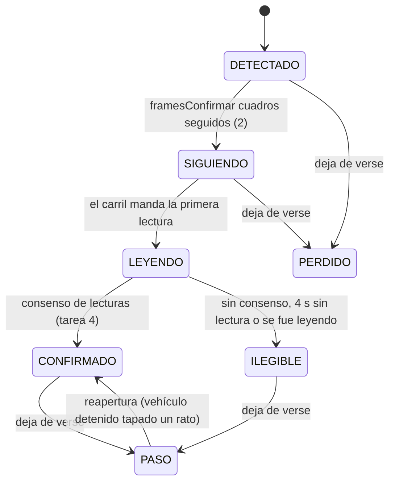

# ANPR continuo (Sprint 10)

Reconocimiento continuo de placas para una cámara IP fija en el carril. El modo por clic («click-to-capture») sigue existiendo
y es el respaldo en todos lados. Este documento se escribió **antes** de programar (exploración y plan) y se completa tarea por
tarea; cada sección dice qué está hecho, qué quedó detrás de bandera y qué falta validar con hardware real.

> **Estado:** en curso. Ver «Estado por tarea» al final.

## 1. Exploración (resumen, sin cambios de código)

| Pieza | Dónde | Lo que importa para ANPR |
|---|---|---|
| `PRODUCT.md` | — | **No existe en el repo** (ya lo decían `docs/saas_nucleo.md` y `docs/sprint9_continuacion.md`). Se crea en la tarea 8 con lo verificable del README y lo nuevo de ANPR. |
| Puente de cámaras | `desktop/src-tauri/src/camaras/` (`docs/camaras_ip_diseno.md`) | `FuenteFotogramas` entrega el **último JPEG en memoria** y su estado; `esperar_fotograma` da el más nuevo sin colas. ffmpeg mínimo LGPL (RTSP→MJPEG 960 px, 10 fps) o proxy MJPEG. Credenciales en el llavero, SSRF validado. ANPR consume esta interfaz: **no abre otra conexión a la cámara**. |
| OCR local | `desktop/sidecar-ocr/src/server.js` | Proceso Node hijo de Tauri, JSON por líneas, `ppu-paddle-ocr` (PP-OCRv5 mobile det + rec «en») sobre `onnxruntime-node` 1.30 (CPU). Atiende en serie; nunca escribe a disco (`privacidad.test.js` lo vigila). Modelos fuera de git, descargados por `scripts/fetch-models.mjs` con SHA-256 fijo. |
| Regex de placa | `desktop/src/lib/placa.ts` | Prefijo 1–3 letras + 3 dígitos + 3 letras; corrección por posición O/0, I/1, B/8…; `correcciones > 0` ⇒ `requiereRevision`. Vive en TypeScript (WebView); el sidecar no la tenía. |
| Ciclo de vida del sidecar | `desktop/src-tauri/src/ocr.rs` | `asegurar_arrancado` lanza `node server.js --models …`, espera `{"evento":"listo"}`, correlaciona respuestas por `id`, 20 s de tope por inferencia. |
| Base local | `desktop/src-tauri/src/db.rs` | SQLCipher (AES-256, clave Argon2id de huella + licencia). Espejo: `residentes_local`, `blacklist_local` (DPI o placa), `preautorizaciones_local`, `invitaciones_qr_local`; cola `accesos_pendientes` (payload exacto del POST, `id_cliente` UUID). Migraciones idempotentes por columna. |
| Cola offline | `desktop/src-tauri/src/sync.rs` | Push cada 30 s con backoff 5 s→10 min; 2xx = sincronizado, 4xx de negocio = rechazado (visible), red/sesión = detener. Pull completo de `GET /sync/garita` cada 5 min. |
| Talanquera | `desktop/src-tauri/src/hardware/` | Trait `TalanqueraDriver` (relé USB, Ethernet TCP/HTTP, GPIO stub). Regla: un fallo de apertura **nunca** revierte un acceso registrado. |
| Snapshot | `backend/src/controllers/sync.controller.ts` | Doble llave (JWT de agente + licencia del equipo, misma sucursal). Pull completo, sin versionado. Empresa suspendida ⇒ 423 desde `verifyLicencia`. |
| `registros_acceso` | `database/init.sql` | `visitante_id NOT NULL` (todo acceso era de un visitante); `origen IN ('web','desktop')`; `id_cliente` único = idempotencia. Migraciones en el mismo `init.sql`, idempotentes (`DO $$ … EXCEPTION`). **No existe una tabla de vehículos de residentes** (`vehiculos` cuelga de `visitantes`). |
| Auditoría | `backend/src/middleware/audit.middleware.ts` | `auditLog({accion})` escribe al terminar con el código HTTP; detalle en `res.locals.auditoria`. Toda acción nueva va en `docs/acciones_sensibles.md` y en las traducciones de la web (lo vigilan `auditoria.cobertura.test.ts` y `auditoria.test.ts`). |
| Configuración por equipo | `desktop/src/lib/camaras.ts`, `ThemeContext.tsx`, `config_hardware` | Tema y disposición de cámaras en `localStorage` del WebView (del puesto, no del agente); talanquera y cámaras IP en SQLCipher (del equipo). |

Línea base antes de tocar nada (22/10/2026, este contenedor): backend unitarias 834/834; integración 426/427 (un fallo
intermitente en `contacto.int.test.ts` que no se repite al reintentar, preexistente); escritorio Vitest 168/168; frontend
576/576; `cargo test --lib` 205 (2 ignoradas); sidecar `node --test` 37 (1 omitida: necesita mediamtx).

## 2. Decisiones de arquitectura

1. **Proceso aparte para ANPR** (`sidecar-ocr/src/anpr/servidor.js`, mismo runtime Node empaquetado). El OCR por clic sigue en su
   proceso y con su cola: ANPR no le roba turnos ni puede tumbarlo. «Pausar ANPR» mata solo este proceso. Coste: RAM de un
   segundo motor de OCR (se mide en la tarea 7).
2. **Los fotogramas los entrega Rust** desde `FuenteFotogramas` (JPEG en base64 por stdin). El sidecar contesta con el fps que
   quiere (1 fps en reposo, 5 fps con movimiento) y Rust lo respeta: en reposo no se decodifica nada de más.
3. **Detector: YOLOX-Nano** (Megvii, **Apache-2.0**), ONNX oficial 416×416. Ultralytics YOLOv5/v8/v11 son AGPL-3.0 y
   YOLOv6/v7/v9 GPL-3.0: descartados por licencia. Clases COCO útiles: `car`→carro, `motorcycle`→moto, `bus`→bus,
   `truck`→camión. COCO no separa «camioneta»: una pickup sale como `car` o `truck`; la clase es informativa y no cambia la decisión.
4. **Regex de placa en el sidecar**: copia en JS de `desktop/src/lib/placa.ts`, con una prueba de paridad en Vitest que compara
   ambas sobre el mismo corpus (si una cambia sin la otra, falla).
5. **La decisión es de Rust** contra el espejo SQLCipher: funciona sin internet y reusa la cola `accesos_pendientes`.
6. **Evidencia** (recorte de placa y de la parte baja del vehículo, JPEG): el sidecar la devuelve en memoria, Rust la guarda
   **cifrada en SQLCipher** y la purga a los 7 días; se sube al backend después de sincronizar el acceso. El sidecar sigue sin
   escribir a disco.
7. **Modelo de datos**: tabla nueva `vehiculos_residentes` (placa normalizada, vigencia, versión para sincronizar cambios);
   `registros_acceso.visitante_id` pasa a admitir NULL **solo** cuando el acceso es de un vehículo de residente (CHECK).
8. **Configuración por carril** en SQLCipher (`carriles_anpr`, del equipo como la talanquera y las cámaras), con la bandera
   global «Pausar ANPR» en `meta`. Carril nuevo: `apagado`; al habilitarlo el modo por defecto es `automatico` (decisión del equipo).
9. **Actuador**: trait `ActuadorBarrera` con `Simulado` (registro + señal en la UI), `ReleHttp` (URL, método, timeout, un solo
   reintento; solo direcciones privadas, mismo validador SSRF que las cámaras) y un adaptador a la talanquera ya configurada.
   Un fallo del actuador es una alerta, nunca deshace el registro.

## 3. Barandas (sección 0 del sprint)

Se auto-autoriza **solo si todo** se cumple: placa en `vehiculos_autorizados_local` activa y vigente hoy, residente activo en el
espejo, fuera de lista negra, licencia utilizable (empresa no suspendida), consenso alcanzado y **ninguna** corrección por
posición en las lecturas ganadoras. Lista negra ⇒ alerta visible y sonora, nunca abre. Desconocida, ilegible o corregida ⇒
verificación del agente con la evidencia. Un evento por pista; 60 s de enfriamiento por placa. Modo por carril
`apagado | verificacion | automatico`.

## 4. Plan por tarea

| # | Entregable | Pruebas |
|---|---|---|
| 1 | `anpr/reloj.js`, `anpr/roi.js`, `anpr/movimiento.js`: diferencia de grises suavizada dentro del ROI, histéresis, fps de reposo | `node --test` con fotogramas sintéticos y reloj falso |
| 2 | `anpr/detector.js` (letterbox, decodificación YOLOX, NMS, filtro ROI), `fetch-models.mjs` con YOLOX-Nano y SHA-256, `test-fixtures/anpr/` | post-proceso con tensores fijos; detección real sobre los clips (se omite sin modelos) |
| 3 | `anpr/tracker.js`: IoU + centroide, pérdida tolerada, máquina de estados, una decisión por pista, enfriamiento | trayectorias sintéticas (a)–(e) |
| 4 | `anpr/consenso.js`, `anpr/placa.js`, `anpr/evidencia.js`, `anpr/carril.js`, `anpr/servidor.js` | lecturas simuladas; regresión del OCR por clic |
| 5 | Migración + `vehiculos_residentes` + `/sync/garita` versionado + `POST /accesos/anpr*`; Rust `anpr/` (decisión, actuador, eventos, motor) | Jest unitarias + integración (Postgres); `cargo test` de cada rama |
| 6 | Panel ANPR en la garita, lista de eventos, «Corregir», alertas, configuración por carril con ROI dibujable, «Pausar ANPR» | Vitest/RTL, accesibilidad básica |
| 7 | `desktop/scripts/medir-anpr.mjs` | reporte reproducible |
| 8 | E2E con clip de ffmpeg, CI, documentación final | — |

## 5. Tarea 1 — Movimiento y ROI por carril

Código: `desktop/sidecar-ocr/src/anpr/{reloj,roi,movimiento,imagen}.js`. Pruebas: `movimiento.test.js` (fotogramas sintéticos
de 160×90 con ruido determinista y `RelojFalso`).

- **ROI**: polígono normalizado (0–1), de 3 a 32 vértices; sin ROI = todo el cuadro. Un ROI mal escrito es un error, no «todo el
  cuadro» en silencio. `fraccionDentro(caja)` (rejilla de 5×5) lo usa el detector de vehículos para descartar el carril de al lado.
- **Movimiento**: el cuadro se reduce a 160 px de ancho en gris, se suaviza (caja 3×3) y se resta del anterior **solo dentro
  del ROI**, descontando la diferencia media (un cambio de exposición o una nube no es movimiento). `cambio` = fracción de píxeles
  del ROI con diferencia > `umbralPixel` (18).
- **Histéresis** por cuadros: `framesActivar` = 3 (al restar cuadros, un destello de UN cuadro produce DOS diferencias; con 2 se
  colaba), `framesDesactivar` = 6 (~1,2 s a 5 fps).
- **Ritmo**: 1 fps en reposo y 5 fps con movimiento; el primer cuadro sospechoso ya pide 5 fps para confirmar en ~0,4 s en vez
  de 3 s. `Ritmo` descarta los cuadros que llegan antes de tiempo. Quien entrega los cuadros (Rust) respeta el fps pedido.
- **Salida**: `movimiento_inicio` / `movimiento_fin` (con `duracion_ms`) con la hora del reloj inyectado.
- Costo medido en la prueba: < 1 ms por cuadro de 160×90 en este Xeon (tope de la prueba: 15 ms, para runners lentos).

Límite conocido: restar cuadros no ve un vehículo **detenido**. Por eso el carril (tarea 4) mantiene despierto el detector
mientras haya una pista sin decidir, aunque el movimiento haya terminado.

## 6. Tarea 2 — Detector de vehículos (YOLOX-Nano)

Código: `desktop/sidecar-ocr/src/anpr/detector.js` (+ `clip.js`, lector de clips para pruebas y medición). Modelo:
`yolox_nano.onnx` (3,5 MB) descargado por `sidecar-ocr/scripts/fetch-models.mjs` desde el release oficial con SHA-256 fijo
`c789161e…18a0b7d`; **no va a git** (la carpeta `models/` sigue ignorada). `prepare-sidecar.mjs` ahora corre siempre
`fetch-models.mjs` (es idempotente) para que una carpeta de modelos anterior al Sprint 10 se complete sola.

**Licencia**: YOLOX (código y pesos publicados en sus releases) es **Apache-2.0**, © Megvii Inc.
(<https://github.com/Megvii-BaseDetection/YOLOX/blob/main/LICENSE>). Permite uso comercial y redistribución con el aviso de
licencia: el instalador debe incluir el texto de Apache-2.0 junto a los modelos (pendiente de sumar al aviso de terceros del
instalador, igual que la licencia LGPL de ffmpeg). Los pesos se entrenaron con COCO (anotaciones CC BY 4.0). Se descartaron
Ultralytics YOLOv5/v8/YOLO11 (AGPL-3.0), YOLOv6/v7/v9 (GPL-3.0) y YOLOv10 (AGPL-3.0). *No es asesoría legal.*

- Pre-proceso de YOLOX: letterbox 416×416 **arriba a la izquierda**, relleno 114, BGR, sin normalizar.
- Post-proceso: decodificación de las rejillas 8/16/32, puntaje = objetualidad × mejor clase de vehículo, NMS **sin distinguir
  clase** (IoU 0,45: una pickup vista como `car` y `truck` es un solo vehículo), umbral 0,35, y filtro por ROI (≥ 30 % de la caja
  dentro, rejilla de 5×5). Clases: `car`→`carro`, `motorcycle`→`moto`, `bus`→`bus`, `truck`→`camion`.
- Salida por fotograma: `{cajas: [{clase, confianza, bbox, en_roi}], descartadas, ms}`.

**Fixtures** (`test-fixtures/anpr/`, ver su README): dos fotos CC0 de Wikimedia Commons (placa en blanco de origen) y todo lo
demás sintético; 7 clips de 960×540 a 10 fps (5,3 MB en total). Un vehículo dibujado solo por código **no sirve**: YOLOX lo
clasificó como avión (`airplane`), por eso se usan fotos reales con licencia libre.

**Medido** (este contenedor: Xeon 2,8 GHz, 4 vCPU, Linux; clip `entrada_p123abc` a 5 fps, incluye letterbox y post-proceso):

| Hilos de ONNX | Mediana | p95 |
|---|---|---|
| 1 | 34,7 ms | 50,7 ms |
| 2 (por defecto) | 24,3 ms | 33,6 ms |
| 4 | 21,7 ms | 38,7 ms |

A 5 fps con movimiento son ~12–17 % de un núcleo; en reposo el detector no corre. Sin vehículo en el ROI (`vacio`,
`carril_vecino`) no hay ninguna detección aceptada; con el vehículo en el ROI se detecta en todos los cuadros en que está
completo (`00000111…11100000`), siempre una sola caja.

## 7. Tarea 3 — Seguimiento (tracker) y máquina de estados

Código: `desktop/sidecar-ocr/src/anpr/tracker.js`. Pruebas: `tracker.test.js` (trayectorias sintéticas, `RelojFalso`).

- **Asociación**: IoU (≥ 0,2, el mayor primero) y, para lo que quede, distancia de centroides (≤ 12 % de la diagonal) con
  tamaño parecido (área entre ½ y 2×: una moto no se pega a la pista de un bus).
- **Pérdida tolerada**: 8 cuadros (~1,6 s a 5 fps) sin verla antes de terminar la pista (oclusión corta = misma pista).
- **Reapertura**: durante 5 s una detección en el mismo lugar reabre la pista con su mismo id y su decisión. **Solo** si la
  pista estaba casi quieta (≤ 1 % de la diagonal por cuadro) y lejos del borde: la de un vehículo que se iba no se reabre, para
  que el siguiente que llega al mismo punto no herede su decisión (prueba «(c′)»).
- **Una decisión por pista** (`decidida`). Si una pista que se estaba leyendo se va sin consenso, se emite `ilegible` con
  motivo `se_fue_sin_lectura`: el agente se entera de que pasó un vehículo sin placa leída.
- **Enfriamiento de 60 s por placa**, contado desde la ÚLTIMA vez que se vio el vehículo con esa placa (no desde la
  confirmación): un carro estacionado que se re-detecta tras perderse no genera otro evento.
- **Tiempo máximo de lectura**: 4 s (configurable) desde que la pista pasa a LEYENDO → ILEGIBLE.
- Todos los tiempos salen del reloj inyectado; los eventos de transición se entregan en orden por `actualizar()` /
  `tomarEventos()`.

Aceptación cubierta: (a) un carro cruzando = un evento; (b) detenido 2 min (con pérdidas cortas) = un evento, y (b′) tapado
más que la tolerancia = reapertura sin segundo evento; (c) dos carros seguidos = dos pistas y dos eventos, y (c′) el segundo
no hereda la pista del primero; (d) oclusión corta no parte la pista; (e) la misma placa dentro de 60 s se ignora y después
no.

## 8. Deuda técnica encontrada (para el informe)

Se llena con cada `refactor(...)` que haga falta.

## 9. Estado por tarea

| Tarea | Estado | Bandera | Pendiente |
|---|---|---|---|
| 1 Movimiento y ROI | hecho | — | Calibrar `umbralCambio`/`umbralPixel` con la cámara real (lluvia, noche, faros) |
| 2 Detector | hecho | — | Exactitud con cámara real (noche, lluvia, motos); aviso de licencia Apache-2.0 en el instalador |
| 3 Tracker | hecho | — | Ajustar `iouMin`, pérdida y reapertura con video real (motos entre carros, colas en la talanquera) |
| 4 Consenso y evidencia | pendiente | — | — |
| 5 Decisión y actuador | pendiente | — | — |
| 6 Interfaz | pendiente | — | — |
| 7 Medición | pendiente | — | — |
| 8 Pruebas integradas y docs | pendiente | — | — |
