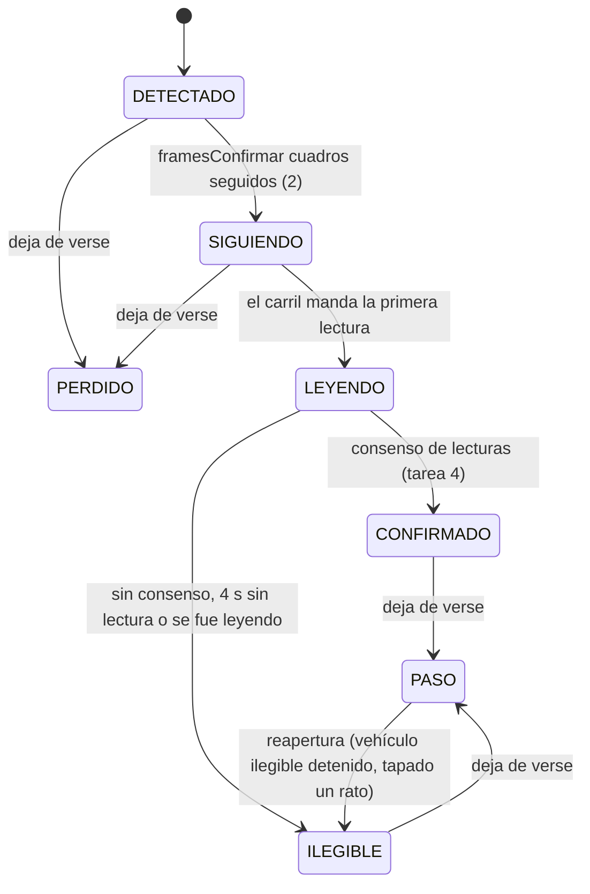
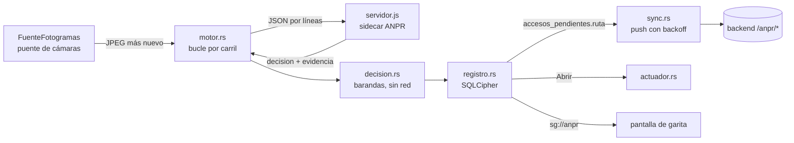
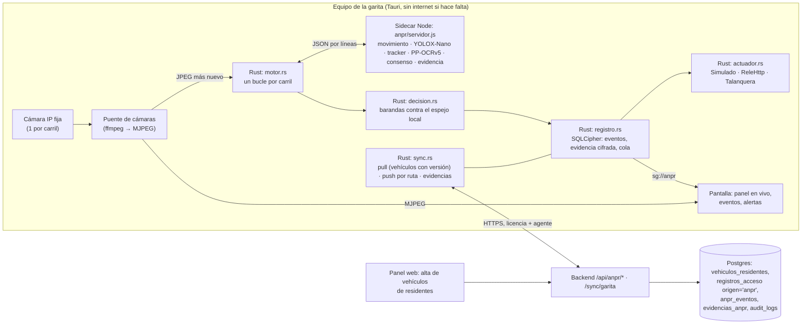

# ANPR continuo (Sprint 10)

Reconocimiento continuo de placas para una cámara IP fija en el carril. El modo por clic («click-to-capture») sigue existiendo
y es el respaldo en todos lados. Este documento se escribió **antes** de programar (exploración y plan) y se completa tarea por
tarea; cada sección dice qué está hecho, qué quedó detrás de bandera y qué falta validar con hardware real.

> **Estado:** en curso. Ver «Estado por tarea» al final.

## 1. Exploración (resumen, sin cambios de código)

| Pieza | Dónde | Lo que importa para ANPR |
|---|---|---|
| `PRODUCT.md` | — | **No existe en el repo** (ya lo decían `docs/saas_nucleo.md` y `docs/sprint9_continuacion.md`). Se crea en la tarea 8 con lo verificable del README y lo nuevo de ANPR. |
| Puente de cámaras | `desktop/src-tauri/src/camaras/` (`docs/camaras_ip_diseno.md`) | `FuenteFotogramas` entrega el **último JPEG en memoria** y su estado; `esperar_fotograma` da el más nuevo sin colas. ffmpeg mínimo LGPL (RTSP→MJPEG 960 px, 10 fps) o proxy MJPEG. Credenciales en el llavero, SSRF validado. ANPR consume esta interfaz: **no abre otra conexión a la cámara**. |
| OCR local | `desktop/sidecar-ocr/src/server.js` | Proceso Node hijo de Tauri, JSON por líneas, `ppu-paddle-ocr` (PP-OCRv5 mobile det + rec «en») sobre `onnxruntime-node` 1.30 (CPU). Atiende en serie; nunca escribe a disco (`privacidad.test.js` lo vigila). Modelos fuera de git, descargados por `scripts/fetch-models.mjs` con SHA-256 fijo. |
| Regex de placa | `desktop/src/lib/placa.ts` | Prefijo 1–3 letras + 3 dígitos + 3 letras; corrección por posición O/0, I/1, B/8…; `correcciones > 0` ⇒ `requiereRevision`. Vive en TypeScript (WebView); el sidecar no la tenía. |
| Ciclo de vida del sidecar | `desktop/src-tauri/src/ocr.rs` | `asegurar_arrancado` lanza `node server.js --models …`, espera `{"evento":"listo"}`, correlaciona respuestas por `id`, 20 s de tope por inferencia. |
| Base local | `desktop/src-tauri/src/db.rs` | SQLCipher (AES-256, clave Argon2id de huella + licencia). Espejo: `residentes_local`, `blacklist_local` (DPI o placa), `preautorizaciones_local`, `invitaciones_qr_local`; cola `accesos_pendientes` (payload exacto del POST, `id_cliente` UUID). Migraciones idempotentes por columna. |
| Cola offline | `desktop/src-tauri/src/sync.rs` | Push cada 30 s con backoff 5 s→10 min; 2xx = sincronizado, 4xx de negocio = rechazado (visible), red/sesión = detener. Pull completo de `GET /sync/garita` cada 5 min. |
| Talanquera | `desktop/src-tauri/src/hardware/` | Trait `TalanqueraDriver` (relé USB, Ethernet TCP/HTTP, GPIO stub). Regla: un fallo de apertura **nunca** revierte un acceso registrado. |
| Snapshot | `backend/src/controllers/sync.controller.ts` | Doble llave (JWT de agente + licencia del equipo, misma sucursal). Pull completo, sin versionado. Empresa suspendida ⇒ 423 desde `verifyLicencia`. |
| `registros_acceso` | `database/init.sql` | `visitante_id NOT NULL` (todo acceso era de un visitante); `origen IN ('web','desktop')`; `id_cliente` único = idempotencia. Migraciones en el mismo `init.sql`, idempotentes (`DO $$ … EXCEPTION`). **No existe una tabla de vehículos de residentes** (`vehiculos` cuelga de `visitantes`). |
| Auditoría | `backend/src/middleware/audit.middleware.ts` | `auditLog({accion})` escribe al terminar con el código HTTP; detalle en `res.locals.auditoria`. Toda acción nueva va en `docs/acciones_sensibles.md` y en las traducciones de la web (lo vigilan `auditoria.cobertura.test.ts` y `auditoria.test.ts`). |
| Configuración por equipo | `desktop/src/lib/camaras.ts`, `ThemeContext.tsx`, `config_hardware` | Tema y disposición de cámaras en `localStorage` del WebView (del puesto, no del agente); talanquera y cámaras IP en SQLCipher (del equipo). |

Línea base antes de tocar nada (22/10/2026, este contenedor): backend unitarias 834/834; integración 426/427 (un fallo
intermitente en `contacto.int.test.ts` que no se repite al reintentar, preexistente); escritorio Vitest 168/168; frontend
576/576; `cargo test --lib` 205 (2 ignoradas); sidecar `node --test` 37 (1 omitida: necesita mediamtx).

## 2. Decisiones de arquitectura

1. **Proceso aparte para ANPR** (`sidecar-ocr/src/anpr/servidor.js`, mismo runtime Node empaquetado). El OCR por clic sigue en su
   proceso y con su cola: ANPR no le roba turnos ni puede tumbarlo. «Pausar ANPR» mata solo este proceso. Coste: RAM de un
   segundo motor de OCR (se mide en la tarea 7).
2. **Los fotogramas los entrega Rust** desde `FuenteFotogramas` (JPEG en base64 por stdin). El sidecar contesta con el fps que
   quiere (1 fps en reposo, 5 fps con movimiento) y Rust lo respeta: en reposo no se decodifica nada de más.
3. **Detector: YOLOX-Nano** (Megvii, **Apache-2.0**), ONNX oficial 416×416. Ultralytics YOLOv5/v8/v11 son AGPL-3.0 y
   YOLOv6/v7/v9 GPL-3.0: descartados por licencia. Clases COCO útiles: `car`→carro, `motorcycle`→moto, `bus`→bus,
   `truck`→camión. COCO no separa «camioneta»: una pickup sale como `car` o `truck`; la clase es informativa y no cambia la decisión.
4. **Regex de placa en el sidecar**: copia en JS de `desktop/src/lib/placa.ts`, con una prueba de paridad en Vitest que compara
   ambas sobre el mismo corpus (si una cambia sin la otra, falla).
5. **La decisión es de Rust** contra el espejo SQLCipher: funciona sin internet y reusa la cola `accesos_pendientes`.
6. **Evidencia** (recorte de placa y de la parte baja del vehículo, JPEG): el sidecar la devuelve en memoria, Rust la guarda
   **cifrada en SQLCipher** y la purga a los 7 días; se sube al backend después de sincronizar el acceso. El sidecar sigue sin
   escribir a disco.
7. **Modelo de datos**: tabla nueva `vehiculos_residentes` (placa normalizada, vigencia, versión para sincronizar cambios);
   `registros_acceso.visitante_id` pasa a admitir NULL **solo** cuando el acceso es de un vehículo de residente (CHECK).
8. **Configuración por carril** en SQLCipher (`carriles_anpr`, del equipo como la talanquera y las cámaras), con la bandera
   global «Pausar ANPR» en `meta`. Carril nuevo: `apagado`; al habilitarlo el modo por defecto es `automatico` (decisión del equipo).
9. **Actuador**: trait `ActuadorBarrera` con `Simulado` (registro + señal en la UI), `ReleHttp` (URL, método, timeout, un solo
   reintento; solo direcciones privadas, mismo validador SSRF que las cámaras) y un adaptador a la talanquera ya configurada.
   Un fallo del actuador es una alerta, nunca deshace el registro.

## 3. Barandas (sección 0 del sprint)

Se auto-autoriza **solo si todo** se cumple: placa en `vehiculos_autorizados_local` activa y vigente hoy, residente activo en el
espejo, fuera de lista negra, licencia utilizable (empresa no suspendida), consenso alcanzado y **ninguna** corrección por
posición en las lecturas ganadoras. Lista negra ⇒ alerta visible y sonora, nunca abre. Desconocida, ilegible o corregida ⇒
verificación del agente con la evidencia. Un evento por pista; 60 s de enfriamiento por placa. Modo por carril
`apagado | verificacion | automatico`.

## 4. Plan por tarea

| # | Entregable | Pruebas |
|---|---|---|
| 1 | `anpr/reloj.js`, `anpr/roi.js`, `anpr/movimiento.js`: diferencia de grises suavizada dentro del ROI, histéresis, fps de reposo | `node --test` con fotogramas sintéticos y reloj falso |
| 2 | `anpr/detector.js` (letterbox, decodificación YOLOX, NMS, filtro ROI), `fetch-models.mjs` con YOLOX-Nano y SHA-256, `test-fixtures/anpr/` | post-proceso con tensores fijos; detección real sobre los clips (se omite sin modelos) |
| 3 | `anpr/tracker.js`: IoU + centroide, pérdida tolerada, máquina de estados, una decisión por pista, enfriamiento | trayectorias sintéticas (a)–(e) |
| 4 | `anpr/consenso.js`, `anpr/placa.js`, `anpr/evidencia.js`, `anpr/carril.js`, `anpr/servidor.js` | lecturas simuladas; regresión del OCR por clic |
| 5 | Migración + `vehiculos_residentes` + `/sync/garita` versionado + `POST /accesos/anpr*`; Rust `anpr/` (decisión, actuador, eventos, motor) | Jest unitarias + integración (Postgres); `cargo test` de cada rama |
| 6 | Panel ANPR en la garita, lista de eventos, «Corregir», alertas, configuración por carril con ROI dibujable, «Pausar ANPR» | Vitest/RTL, accesibilidad básica |
| 7 | `desktop/scripts/medir-anpr.mjs` | reporte reproducible |
| 8 | E2E con clip de ffmpeg, CI, documentación final | — |

## 5. Tarea 1 — Movimiento y ROI por carril

Código: `desktop/sidecar-ocr/src/anpr/{reloj,roi,movimiento,imagen}.js`. Pruebas: `movimiento.test.js` (fotogramas sintéticos
de 160×90 con ruido determinista y `RelojFalso`).

- **ROI**: polígono normalizado (0–1), de 3 a 32 vértices; sin ROI = todo el cuadro. Un ROI mal escrito es un error, no «todo el
  cuadro» en silencio. `fraccionDentro(caja)` (rejilla de 5×5) lo usa el detector de vehículos para descartar el carril de al lado.
- **Movimiento**: el cuadro se reduce a 160 px de ancho en gris, se suaviza (caja 3×3) y se resta del anterior **solo dentro
  del ROI**, descontando la diferencia media (un cambio de exposición o una nube no es movimiento). `cambio` = fracción de píxeles
  del ROI con diferencia > `umbralPixel` (18).
- **Histéresis** por cuadros: `framesActivar` = 3 (al restar cuadros, un destello de UN cuadro produce DOS diferencias; con 2 se
  colaba), `framesDesactivar` = 6 (~1,2 s a 5 fps).
- **Ritmo**: 1 fps en reposo y 5 fps con movimiento; el primer cuadro sospechoso ya pide 5 fps para confirmar en ~0,4 s en vez
  de 3 s. `Ritmo` descarta los cuadros que llegan antes de tiempo. Quien entrega los cuadros (Rust) respeta el fps pedido.
- **Salida**: `movimiento_inicio` / `movimiento_fin` (con `duracion_ms`) con la hora del reloj inyectado.
- Costo medido en la prueba: < 1 ms por cuadro de 160×90 en este Xeon (tope de la prueba: 15 ms, para runners lentos).

Límite conocido: restar cuadros no ve un vehículo **detenido**. Por eso el carril (tarea 4) mantiene despierto el detector
mientras haya una pista sin decidir, aunque el movimiento haya terminado.

## 6. Tarea 2 — Detector de vehículos (YOLOX-Nano)

Código: `desktop/sidecar-ocr/src/anpr/detector.js` (+ `clip.js`, lector de clips para pruebas y medición). Modelo:
`yolox_nano.onnx` (3,5 MB) descargado por `sidecar-ocr/scripts/fetch-models.mjs` desde el release oficial con SHA-256 fijo
`c789161e…18a0b7d`; **no va a git** (la carpeta `models/` sigue ignorada). `prepare-sidecar.mjs` ahora corre siempre
`fetch-models.mjs` (es idempotente) para que una carpeta de modelos anterior al Sprint 10 se complete sola.

**Licencia**: YOLOX (código y pesos publicados en sus releases) es **Apache-2.0**, © Megvii Inc.
(<https://github.com/Megvii-BaseDetection/YOLOX/blob/main/LICENSE>). Permite uso comercial y redistribución con el aviso de
licencia: el instalador debe incluir el texto de Apache-2.0 junto a los modelos (pendiente de sumar al aviso de terceros del
instalador, igual que la licencia LGPL de ffmpeg). Los pesos se entrenaron con COCO (anotaciones CC BY 4.0). Se descartaron
Ultralytics YOLOv5/v8/YOLO11 (AGPL-3.0), YOLOv6/v7/v9 (GPL-3.0) y YOLOv10 (AGPL-3.0). *No es asesoría legal.*

- Pre-proceso de YOLOX: letterbox 416×416 **arriba a la izquierda**, relleno 114, BGR, sin normalizar.
- Post-proceso: decodificación de las rejillas 8/16/32, puntaje = objetualidad × mejor clase de vehículo, NMS **sin distinguir
  clase** (IoU 0,45: una pickup vista como `car` y `truck` es un solo vehículo), umbral 0,35, y filtro por ROI (≥ 30 % de la caja
  dentro, rejilla de 5×5). Clases: `car`→`carro`, `motorcycle`→`moto`, `bus`→`bus`, `truck`→`camion`.
- Salida por fotograma: `{cajas: [{clase, confianza, bbox, en_roi}], descartadas, ms}`.

**Fixtures** (`test-fixtures/anpr/`, ver su README): dos fotos CC0 de Wikimedia Commons (placa en blanco de origen) y todo lo
demás sintético; 7 clips de 960×540 a 10 fps (5,3 MB en total). Un vehículo dibujado solo por código **no sirve**: YOLOX lo
clasificó como avión (`airplane`), por eso se usan fotos reales con licencia libre.

**Medido** (este contenedor: Xeon 2,8 GHz, 4 vCPU, Linux; clip `entrada_p123abc` a 5 fps, incluye letterbox y post-proceso):

| Hilos de ONNX | Mediana | p95 |
|---|---|---|
| 1 | 34,7 ms | 50,7 ms |
| 2 (por defecto) | 24,3 ms | 33,6 ms |
| 4 | 21,7 ms | 38,7 ms |

A 5 fps con movimiento son ~12–17 % de un núcleo; en reposo el detector no corre. Sin vehículo en el ROI (`vacio`,
`carril_vecino`) no hay ninguna detección aceptada; con el vehículo en el ROI se detecta en todos los cuadros en que está
completo (`00000111…11100000`). En los clips de entrada YOLOX-Nano a veces suma una caja débil (0,36–0,41) sobre la mitad
trasera del mismo carro (IoU 0,19–0,39 con la buena, contenida 61–79 %): desde la tarea 7 el NMS también descarta la caja
contenida ≥ 60 % en otra más confiable de la misma familia (una moto dentro de la caja de un carro se conserva), y queda una
sola caja por vehículo en todos los clips.

## 7. Tarea 3 — Seguimiento (tracker) y máquina de estados

Código: `desktop/sidecar-ocr/src/anpr/tracker.js`. Pruebas: `tracker.test.js` (trayectorias sintéticas, `RelojFalso`).

- **Asociación**: IoU (≥ 0,2, el mayor primero) y, para lo que quede, distancia de centroides (≤ 12 % de la diagonal); en los dos
  casos con tamaño parecido (área entre ½ y 2×: una moto no se pega a la pista de un bus, ni una pista vieja al vehículo siguiente).
- **Pérdida tolerada**: 8 cuadros (~1,6 s a 5 fps) **o** 2 s sin verla, lo que pase primero (oclusión corta = misma pista); si
  la última vez tocaba el borde del cuadro (salió), 2 cuadros. Ver el fallo corregido en la tarea 4.
- **Reapertura**: durante 5 s una detección en el mismo lugar reabre la pista con su mismo id y su decisión. **Solo** si la
  pista estaba casi quieta (≤ 1 % de la diagonal por cuadro), lejos del borde y **sin placa confirmada** (desde la tarea 7): la de
  un vehículo que se iba, o la de uno ya leído, no se reabre, para que el siguiente que llega al mismo punto no herede su
  decisión (pruebas «(c′)» y «cola en la talanquera»).
- **Una decisión por pista** (`decidida`). Si una pista que se estaba leyendo se va sin consenso, se emite `ilegible` con
  motivo `se_fue_sin_lectura`: el agente se entera de que pasó un vehículo sin placa leída.
- **Enfriamiento de 60 s por placa**, contado desde la ÚLTIMA vez que se vio el vehículo con esa placa (no desde la
  confirmación): un carro estacionado que se re-detecta tras perderse no genera otro evento.
- **Tiempo máximo de lectura**: 4 s (configurable) desde que la pista pasa a LEYENDO → ILEGIBLE.
- **Cambios de la tarea 7** (encontrados midiendo con los clips reales): una detección sin pista contenida ≥ 60 % en un vehículo
  de la misma familia que se ve en ese cuadro no abre pista (era un segundo evento del mismo carro); y una pista con **placa
  confirmada no se reabre** (la reapertura le pegaba la decisión vieja al carro siguiente de una cola, que pasaba sin evento): si
  es el mismo carro, la pista nueva relee la placa y el enfriamiento la ignora.
- Todos los tiempos salen del reloj inyectado; los eventos de transición se entregan en orden por `actualizar()` /
  `tomarEventos()`.

Aceptación cubierta: (a) un carro cruzando = un evento; (b) detenido 2 min (con pérdidas cortas) = un evento, y (b′) tapado
más que la tolerancia = sin segundo evento (con placa ya confirmada, pista nueva que el enfriamiento ignora; ilegible, la pista
se reabre); (c) dos carros seguidos = dos pistas y dos eventos, y (c′) el segundo
no hereda la pista del primero; (d) oclusión corta no parte la pista; (e) la misma placa dentro de 60 s se ignora y después
no.

## 8. Tarea 4 — Consenso de lecturas y evidencia

Código (sidecar): `anpr/consenso.js`, `anpr/placa.js` (+ `placa.d.ts`), `anpr/evidencia.js`, `anpr/carril.js` (une todo por
cámara) y `anpr/servidor.js` (el proceso ANPR). Pruebas: `consenso.test.js`, `carril.test.js` (detector, OCR y reloj falsos
sobre JPEG sintéticos), `servidor.test.js` (incluye la corrida real con los clips), `ocr-clic.regresion.test.js` y, en el
escritorio, `src/lib/__tests__/placa.paridad.test.ts`.

**Calidad del recorte** (0–1): 45 % tamaño del vehículo en el cuadro, 40 % nitidez (varianza del Laplaciano de la parte baja
del vehículo, en escala log), 15 % posición (centrado). Una caja que toca el borde vale 0 (la placa puede estar cortada). Por
pista se guardan los 5 mejores recortes y se lee como mucho **uno por cuadro**, siempre el mejor pendiente; recortes con calidad
< 0,25 no gastan OCR. La pista pasa a LEYENDO —y empieza a contar su tiempo máximo de 4 s— con el **primer recorte útil**: un
vehículo que entra tocando el borde no gasta ese tiempo esperando. Un vehículo seguido varios cuadros del que nunca hubo un
recorte útil también avisa al agente (`ilegible`, motivo `sin_recorte_util`).

**Lectura**: el MISMO OCR de la captura por clic (`server.js::recognize`, PP-OCRv5) sobre la parte baja del vehículo (desde el
30 % de su altura, con un 12 % de margen a cada lado: la caja de YOLOX se queda corta en una vista de tres cuartos y dejaba la
placa en el borde); su detector de texto ubica la placa. Cuando una lectura ya ubicó la placa, las siguientes recortan alrededor
de ella (±60 %, ampliado a ≥ 240 px de ancho si queda más chico): en `dos_seguidos` la primera lectura tardó 160–230 ms y las
siguientes 50–165 ms. Si la relectura no encuentra la placa donde se esperaba, la siguiente vuelve a la parte baja completa. Después, la regex
guatemalteca (`placa.js`, copia de `lib/placa.ts`; la prueba de paridad compara las dos sobre 32 textos y 6 juegos de fragmentos).

**Consenso** (configurable):

- confirma cuando **≥ 3** lecturas válidas dan la misma placa **y** la confianza agregada **≥ 0,90**;
- confianza agregada = media de la confianza del OCR en las lecturas que coinciden × fracción de lecturas válidas que coinciden.
  Es conservadora a propósito: con el umbral por defecto una sola lectura **válida** discrepante entre 4–5 impide confirmar
  (ante la duda, verificación del agente). Las lecturas sin forma de placa no votan, ni las que tienen forma de placa pero
  confianza del OCR **< 0,75** (`confianzaVoto`): el propio OCR no las cree. Caso real con el equipo muy cargado: `P555TRK` a
  0,93 y después «E055STR» a 0,57; antes esa lectura débil volvía inalcanzable el 0,90 y la pista salía ilegible a la segunda
  lectura;
- dos cupos: **5 lecturas válidas** y **8 intentos** en total. Una lectura sin forma de placa (recorte movido, «GUATEMALA» pegado
  al texto) no es evidencia de OTRA placa: no gasta el cupo de válidas, sí el de intentos;
- se declara **ilegible** en cuanto ni con todas las lecturas restantes perfectas se llegaría (cota optimista), o al agotar un cupo;
- **corrección por posición**: si el consenso **necesita** alguna lectura corregida (menos de 3 lecturas literales en el grupo
  ganador) o el prefijo no es conocido → `requiere_verificacion = true` (nunca abre solo). Tres lecturas literales más una
  corregida que coincide no la necesitan. `alguna_correccion` registra si cualquier lectura se corrigió;
- **una lectura literal más antes de rendirse**: si el consenso ya alcanzaría pero solo gracias a una corrección, y el cupo da
  para las literales que faltan, la pista sigue leyendo (`pendiente`, `confirmable`). Si llega la literal, confirma sin
  verificación; si se agota el cupo, el tiempo de lectura o el vehículo se va, sale **confirmada con verificación** (el tracker
  lo cierra CONFIRMADO vía `alCerrarLectura` y entra al enfriamiento). Con el equipo cargado se leen menos cuadros y la corrida
  real a veces cerraba con 2 literales + 1 corregida: ahora espera una más.

**Evidencia**: recorte de la placa (con 20 % de margen, JPEG calidad 85) y de la **parte baja** del vehículo (desde el 45 % de
la altura de su caja: deja fuera parabrisas, medallón y cabina, donde podría verse una cara; máximo 480 px de ancho, calidad
70), del mejor cuadro leído. Viajan en base64 dentro de la decisión hacia Rust, que los guarda cifrados; `expira_ms` = hora de
la decisión + 7 días (la purga la hace Rust, tarea 5). El sidecar sigue sin escribir a disco (la guarda de privacidad cubre
`src/anpr/`). Es una regla geométrica, no un detector de caras: hay que validarla con el encuadre de la cámara real.

**El carril** (`carril.js`): ritmo (1 fps en reposo), movimiento, detector solo con movimiento o con pistas sin decidir, y en
«vigilancia» (pistas ya decididas, sin movimiento) a 1 fps hasta que terminen. Devuelve por cuadro los eventos (`movimiento_*`,
`pista`, `decision`, `ignorada`), las pistas para la superposición y los ms por etapa (`decodificar`, `movimiento`, `detector`,
`tracker`, `ocr`), que usa la medición de la tarea 7.

**Decisión** (lo que recibe Rust): `{tipo: 'decision', carril, track_id, resultado: 'confirmada'|'ilegible', placa,
placa_probable, confianza, votos, lecturas[], requiere_verificacion, alguna_correccion, motivo, clase, ts, ms_desde_legible,
evidencia: {placa_jpeg, vehiculo_jpeg, expira_ms}}`. Ilegible siempre lleva `requiere_verificacion = true` y `placa = null`.

**El OCR por clic no cambia**: `server.js` no se tocó (el ANPR corre en `servidor.js`, otro proceso que solo *importa* su
`recognize`), y `ocr-clic.regresion.test.js` fija por el protocolo real lo que devuelve hoy sobre `test-assets/` (texto exacto
por fragmento, confianza ±0,02). La suite del clic (Vitest de `lib/placa.ts`, DPI, cámara) sigue en verde.

**Corrida real** (proceso ANPR aparte, YOLOX-Nano + OCR, clips reproducidos en tiempo real como los entrega el puente; este
contenedor):

| Clip | Resultado | ms desde la primera lectura legible |
|---|---|---|
| `entrada_p123abc` | confirmada `P123ABC` | 368 |
| `dos_seguidos` | confirmada `P555TRK`, confirmada `U318BCD` | 333 / 384 |
| `ilegible` | ilegible → verificación del agente | — |
| `vacio`, `carril_vecino` | ninguna decisión, ni siquiera despierta | — |

**Robustez bajo carga.** Con la suite del sidecar corriendo en paralelo (CPU saturada) el clip `dos_seguidos` terminaba en
ilegible: la placa del sedán negro quedaba en el borde del recorte (caja de YOLOX corta), las relecturas eran recortes de
~90 px y las lecturas vacías gastaban el cupo. Tras los cuatro ajustes de arriba (margen lateral, ampliar relecturas, cupos
separados, reloj de lectura desde el primer recorte útil) la corrida real pasa 3 de 3 veces con la suite en paralelo y también
con 3 procesos quemando CPU a la vez (latencias de 321 a 1 536 ms desde la primera lectura legible; objetivo < 2 s).

**Fallo encontrado y corregido** durante esta tarea (commit `fix(anpr)` aparte): en `dos_seguidos` el segundo vehículo
**heredaba la pista ya decidida del primero** (la pista vieja seguía viva a 1 fps y se asoció por IoU 0,23 a una caja 2,6 veces
más grande), así que pasaba sin decisión ni aviso. Ahora la asociación exige tamaño parecido también por IoU, una pista termina
por tiempo (2 s sin verla) además de por cuadros, y una que salió por el borde termina a los 2 cuadros.

## 9. Tarea 5 — Decisión, registro `anpr` y actuador

### 9.1 Modelo de datos (backend, `database/init.sql`, idempotente)

| Objeto | Para qué |
|---|---|
| `vehiculos_residentes` | Vehículos **autorizados** de cada residente: placa normalizada (`P123ABC`, CHECK `^[A-Z0-9]{3,20}$`), vigencia (`vigente_desde`/`vigente_hasta`, DATE), `activo` (una baja nunca es DELETE), `version` de una secuencia. Una placa activa por sucursal (índice único parcial). |
| Disparadores de versión | La versión sube con cada UPDATE de la fila, con cualquier cambio de un bloqueo **por placa** en `visitante_blacklist` de esa sucursal y con la baja/alta del usuario del residente: la garita se entera en el pull incremental. |
| `registros_acceso` | Columnas nuevas `confianza` (0–1), `track_id`, `evidencia_ref` (`anpr:<id_cliente>`), `vehiculo_residente_id`, `verificado_por` (agente que confirmó con un toque) e `id_cliente_salida` (salida idempotente). `visitante_id` admite NULL **solo** si hay `vehiculo_residente_id` (CHECK). `origen` admite `'anpr'`. |
| `anpr_eventos` | Lo que no es un acceso pero va a la bitácora: `alerta_lista_negra`, `verificacion_resuelta`, `ilegible`, `actuador_fallo`. PK = `id_cliente` de la garita (idempotente). |
| `evidencias_anpr` | JPEG de placa y de vehículo (≤ 256 KB, `UNIQUE (id_cliente, tipo)`), `expira_en` a 7 días; los purga la tarea programada `anpr.evidencias`. |

Borrado definitivo de una empresa (`empresas.controller.ts`): se agregaron los pasos para `evidencias_anpr`, `anpr_eventos` y
`vehiculos_residentes`, en el orden que exigen las llaves foráneas.

### 9.2 API (`backend/src/routes/anpr.routes.ts`)

| Ruta | Quién | Notas |
|---|---|---|
| `GET/POST /api/anpr/vehiculos`, `PATCH/DELETE /api/anpr/vehiculos/:id` | admin de sucursal o superior, con `tenantFilter` | Alta valida residente de la misma sucursal, placa plausible y vigencia; DELETE = baja (`activo = FALSE`). Bitácora `VEHICULO_RESIDENTE_*`. |
| `POST /api/anpr/accesos` | agente + licencia del equipo (`verifyLicencia`: empresa suspendida → **423**) | Idempotente por `id_cliente`. El servidor **vuelve a validar** (vehículo activo y vigente el día del registro, residente activo, sin bloqueo por placa): si algo cambió mientras la garita estaba sin red responde 409/403 y la cola lo marca «rechazado», igual que con visitantes. Bitácora `ANPR_ACCESO_AUTOMATICO` o `ANPR_ACCESO_VERIFICADO` según el modo. |
| `POST /api/anpr/salidas` | ídem | Cierra el registro abierto más reciente de ese vehículo; idempotente por `id_cliente_salida`. Sin registro abierto → 404 y la cola lo marca «rechazado» (el agente lo ve en «Registrados en este equipo»). |
| `POST /api/anpr/eventos` | ídem | Alerta de lista negra, verificación resuelta, ilegible, falla del actuador. Bitácora con su acción (`ANPR_ALERTA_LISTA_NEGRA`, …). |
| `POST /api/anpr/evidencias` | ídem | Solo para un acceso o evento **ya recibido** de la misma sucursal; JPEG real (firma `FF D8 FF`), ≤ 256 KB, SHA-256 verificado; reenvío idempotente. La ruta usa el límite de cuerpo mayor de `app.ts` (el mismo del logo); el resto de la API sigue con el chico. |
| `GET /api/anpr/evidencias/:id_cliente/:tipo` | personal de la sucursal | Devuelve el JPEG mientras no caduque. |
| `GET /api/sync/garita?vehiculos_desde=N` | (existente) | Agrega `vehiculos: { modo: completo|cambios, version, filas }`. Sin parámetro o `0` → lista completa de los que hoy pueden entrar; con versión → solo lo que cambió (bajas como `activo: false`). Respeta multi-tenant y 423 como el resto del snapshot. |

Las acciones nuevas están en `docs/acciones_sensibles.md`, en la tabla de auditoría del owner (`frontend/src/pages/owner/auditoria.ts`)
y en la prueba I-11 (`auditoria.int.test.ts`), que exige un caso por acción. La matriz de roles de
`security.routes.contract.test.ts` cubre las 9 rutas nuevas.

### 9.3 Garita (Rust, `desktop/src-tauri/src/anpr/`)

- **Espejo local** (`vehiculos_autorizados_local`): `sync.rs` pide `vehiculos_desde` con la versión guardada y aplica los
  cambios; cada 30 min pide la lista completa (cubre una carrera entre dos cambios casi simultáneos y los residentes eliminados).
- **Decisión** (`decision.rs::decidir`), en este orden: carril apagado → nada; no confirmada por consenso → verificación
  (ilegible); **lista negra → alerta, nunca abre** (antes que todo, también con lectura corregida); misma placa en el carril
  hace < 60 s → se ignora; licencia que no permite operar (suspendida, revocada, gracia vencida) → verificación; lectura con
  corrección por posición → verificación; placa desconocida, vehículo dado de baja, fuera de vigencia o residente que ya no está
  en la copia → verificación; todo en orden → `automatico` abre, `verificacion` espera el toque del agente. Hay una prueba
  exhaustiva que recorre todas las combinaciones y comprueba que **ninguna** abre con lista negra, licencia bloqueada o lectura
  corregida.
- **Registro** (`registro.rs`): cada decisión deja un `anpr_eventos_local` y su evidencia **cifrada en SQLCipher**. Lo que va al
  backend usa la cola de siempre (`accesos_pendientes`) con la columna nueva `ruta` (`/anpr/accesos`, `/anpr/salidas`,
  `/anpr/eventos`; lista blanca en `sync.rs`) y `visible = 0` para que los eventos no aparezcan en «Registrados en este equipo».
  El `id_cliente` es el de la fila: los reintentos sin red no duplican. La evidencia sube **después** de que su acceso o evento
  quedó sincronizado (`push_evidencias`, con SHA-256) y se purga a los 7 días (eventos resueltos también).
- **Resolución del agente** (`anpr_resolver`): `Autorizar` (con placa leída o corregida) vuelve a correr **todas** las barandas
  con la placa final: con lista negra, licencia bloqueada o vehículo no autorizado/vigente se rechaza con un mensaje claro y el
  agente usa el registro manual de siempre. `RegistroManual`, `Descartar` y `Enterado` cierran el evento (los dos primeros van a la
  bitácora como `verificacion_resuelta`).
- **Carril de salida**: la placa autorizada encola `/anpr/salidas` y abre la talanquera (si el carril está en automático); el
  backend cierra el registro abierto.
- **Actuador** (`actuador.rs`): trait `ActuadorBarrera` con `Simulado` (por defecto), `ReleHttp` (URL `http://` con IP privada
  literal —mismo validador SSRF que las cámaras—, `GET`/`POST`, timeout configurable, **un** reintento) y `Talanquera` (la ya
  configurada del equipo). Se llama en `spawn_blocking` **después** de encolar el acceso: una falla queda en el evento
  (`apertura = 'fallo: …'`), se encola `actuador_fallo` para la bitácora y la pantalla muestra el aviso, pero el acceso registrado
  no se toca. No se inventó ningún protocolo de relé: el cuerpo y el método son los que configure el integrador.
- **Comandos Tauri**: `anpr_estado`, `anpr_iniciar`, `anpr_detener`, `anpr_pausar`, `anpr_carriles`, `anpr_carril_guardar`,
  `anpr_carril_eliminar`, `anpr_eventos`, `anpr_evidencia`, `anpr_resolver`, `anpr_probar_actuador`; evento `sg://anpr` hacia la
  pantalla (`estado` del carril y `evento` nuevo, con `alerta: true` si es lista negra). Al cerrar la ventana se detiene el
  proceso.

### 9.4 Pendiente de decisión (no tocado por la regla del sprint)

- **Facturación**: `visitasDelMes`, `visitasPorEmpresa` (`services/suscripciones.ts`) y `visitasEnRango`
  (`services/facturacion.ts`) cuentan **toda** fila autorizada de `registros_acceso`; con el ANPR, las entradas de vehículos de
  residentes contarían como visitas. La regla del sprint dice no tocar la facturación, así que queda así y se decide aparte. El
  cambio propuesto es una línea en cada consulta: `AND ra.visitante_id IS NOT NULL`.
- **Listados web de accesos** (`accesos.controller.ts`, `dashboard.controller.ts`, `exportacion.ts`) hacen `JOIN visitantes`:
  los accesos ANPR de residentes **no aparecen** ahí (sí en la bitácora y en la base). Mostrarlos requiere `LEFT JOIN` y una
  columna «vehículo de residente» en la tabla; se deja para un sprint del panel web.

## 10. Tarea 6 — Interfaz de la garita y configuración por carril

Todo en `desktop/src/` (español, sin tocar el kit de UI copiado de la web: `npm run ui:check` sigue en verde).

| Pieza | Qué hace |
|---|---|
| `lib/tauri.ts` | Tipos espejo de los DTO de Rust (`Carril`, `EstadoAnpr`, `EventoAnpr`, `MensajeAnpr`…), `api.anpr.*` y `onAnpr` (evento `sg://anpr`). `AccesoPendiente.origen`. |
| `lib/anpr.ts` | Textos (motivos, estado del carril, resultado de la talanquera), geometría de la superposición (cajas en % del cuadro), ROI (clic → punto 0–1, validación igual a Rust), carril nuevo **apagado**, validación de la URL del relé, sonido de alerta (Web Audio, tres pitidos; sin audio no hace nada). |
| `hooks/useAnpr.ts` | Arranca los carriles al abrir la garita con sesión (`anpr_iniciar`), escucha `sg://anpr` (pistas por carril, evento nuevo arriba, estado de cada carril, resultado de la talanquera), deriva alertas de lista negra, fallas de la talanquera y pendientes; `resolver`, `pausar`. |
| `components/anpr/AnprPanel.tsx` | En la columna de cámaras: estado de cada carril y **vista en vivo** (MJPEG del puente local) con el área del carril y una caja por vehículo con su estado o su placa. Texto `sr-only` con lo que hay en el carril. |
| `components/anpr/AnprEventos.tsx` | Lista en tiempo real (`aria-live="polite"`) con placa, residente, carril, confianza, tiempo desde la primera lectura legible, estado, resultado de la talanquera y evidencia (se pide solo al mostrarse). Si espera al agente: **Autorizar** (un toque), **Corregir** (placa escrita → Rust revisa de nuevo todas las barandas), **Registro manual** (la placa pasa al formulario de siempre), **Descartar**. |
| `components/anpr/AnprAlertas.tsx` | **Lista negra**: banda roja (`role="alert"` en región `aria-live="assertive"`, pulso solo con `motion-safe`) + sonido; queda hasta «Enterado». **Talanquera que no respondió**: banda persistente que dice que el acceso ya quedó registrado y que se abra a mano, hasta «Entendido». |
| `components/anpr/AnprConfigDialog.tsx` | Carriles del equipo: nombre, cámara de red (las USB no sirven: las abre el WebView), sentido, modo (casilla «Reconocer placas en este carril»: al marcarla propone **Automático**; un carril nuevo nace apagado), **área dibujable** con clics sobre una foto de la cámara (deshacer, todo el cuadro), ajustes avanzados (vacío = recomendado) y la talanquera del carril (simulada, relé HTTP propio o el relé de talanquera del equipo) con «Probar talanquera». En pantalla se dice **talanquera**, como en el resto de la garita (glosario); «actuador» queda para el código y esta guía. Se guarda en el SQLCipher del equipo vía Rust. |
| `pages/GaritaPage.tsx` | Botón global **«Pausar ANPR» / «Reanudar ANPR»** en el encabezado (con `aria-pressed`, visible si hay carriles), alertas bajo la tira de estado, panel ANPR bajo las cámaras y eventos sobre «Registrados en este equipo». |
| `RecientesList.tsx` | Las filas del ANPR dicen «Vehículo de residente · ANPR» (sin DPI) y no ofrecen «Dar salida»: la salida de un residente la registra el carril de salida. |

Rust: `auth::cerrar_sesion_local` ahora también detiene el ANPR (cerrar turno o empresa suspendida): sin agente nadie atiende
las verificaciones. Vuelve a arrancar cuando la garita se abre con el siguiente login.

Pruebas (Vitest + Testing Library): `lib/__tests__/anpr.test.ts` (14), `hooks/__tests__/useAnpr.test.tsx` (7),
`components/anpr/__tests__/` (`AnprEventos` + `AnprAlertas` 10, `AnprPanel` 4, `AnprConfigDialog` 6) y un caso nuevo en
`RecientesList.test.tsx`. Cubren regiones vivas, alerta asertiva, «Corregir» con validación y rechazo de Rust, ROI por clics,
relé con prueba sin guardar, y que un carril nuevo nace apagado. Revisión visual: la pantalla se levantó con `vite` e `invoke`
simulado (datos sintéticos) en Chromium, tema oscuro y claro; las capturas no se suben al repositorio.

## 11. Tarea 7 — Medición de rendimiento y exactitud

**Cómo se mide** (`desktop/scripts/medir-anpr.mjs pipeline --release`): la prueba `anpr::pruebas_reales` corre el pipeline de
verdad sin ventana —bucle de Rust (`motor::correr_carril`), sidecar real (`servidor.js`: movimiento, YOLOX-Nano, pista,
PP-OCRv5, consenso, evidencia), decisión contra un SQLCipher real y actuador simulado— con los clips de `test-fixtures/anpr`
decodificados con ffmpeg y entregados **en tiempo real** (10 fps, como el puente). El script muestrea cada segundo, por separado,
el proceso de Rust y el del sidecar (CPU de `/proc/<pid>/stat` en Linux; RAM = RSS) desde que los modelos terminaron de cargar.

- **ms por etapa**: los que devuelve el sidecar por cuadro procesado (`decodificar`, `movimiento`, `detector`, `tracker`, `ocr`).
  El p50 del OCR es 0 porque en la mayoría de los cuadros no se lee (una lectura por cuadro como mucho, solo de pistas en lectura).
- **Latencia de la decisión** = desde la primera lectura **legible** de la placa hasta la decisión del sidecar
  (`ms_desde_legible`) + lo que tarda Rust en decidir, registrar en la base y mandar abrir (`ms_rust_total`). El acercamiento del
  vehículo no cuenta: depende de la calle, no del sistema.
- **Exactitud**: cada decisión se compara con la verdad de terreno del clip en que ocurrió.

**Equipo**: contenedor Linux en la nube, Intel Xeon @ 2,80 GHz × 4 vCPU, 15,7 GB; Rust en perfil release. **No es el equipo de la
garita**: las filas de Windows (6–8 GB) están pendientes en `docs/plantilla_medicion_camaras.md`.

Resultado (`anpr-2026-10-22T21-35-15`, la corrida final, con todos los arreglos de esta tarea):

| Escenario | Rust: CPU (% de un núcleo) / RAM pico | Sidecar: CPU (% de un núcleo) / RAM pico | CPU total de la máquina | Cuadros procesados / publicados |
|---|---|---|---|---|
| Reposo, 2 carriles, calle vacía | 0,4 % / 32 MB | 2,2 % / 345 MB | 0,7 % | 35/355 y 35/355 (1 fps) |
| 1 carril con tráfico (7 clips seguidos) | 0,4 % / 54 MB | 28,2 % / 390 MB | 7,2 % | 225/1052 |
| 2 carriles con tráfico a la vez | 0,6 % / 55 MB | 42,0 % / 402 MB | 10,6 % | 148/628 y 96/634 |

| ms por cuadro procesado (p50 / p95) | decodificar | movimiento | detector | tracker | OCR | total |
|---|---|---|---|---|---|---|
| Reposo | 5,6 / 7,8 | 1,4 / 3,1 | — | — | — | 7,1 / 9,9 |
| 1 carril | 5,2 / 8,8 | 1,3 / 2,8 | 22,9 / 35,3 | 0,1 / 1,1 | 0 / 108,4 | 31,1 / 145,2 |
| 2 carriles | 5,2 / 10,0 | 1,3 / 3,2 | 21,9 / 35,7 | 0,1 / 1,0 | 0 / 97,9 | 29,8 / 128,9 |

| Latencia (ms) | Decisiones | Sidecar desde legible p50 / p95 / máx | Rust registro + orden de abrir p50 / p95 / máx | **Total p95** |
|---|---|---|---|---|
| 1 carril | 6 | 357 / 1409 / 1409 | 8,1 / 23,3 / 23,3 | **1432** |
| 2 carriles | 6 | 641 / 926 / 926 | 7,2 / 17,9 / 17,9 | **944** |

| Exactitud (verdad de terreno) | Vehículos | Abrió con la placa correcta | Al agente con la placa correcta | Ilegible (clip ilegible) | Placa equivocada | Falsas | Sin decisión |
|---|---|---|---|---|---|---|---|
| 1 carril | 6 | 3 | 2 (lista negra C458DFG, desconocida U318BCD) | 1 | 0 | 0 | 0 |
| 2 carriles | 6 | 3 | 2 | 1 | 0 | 0 | 0 |

Repeticiones con el mismo binario (4 corridas más de cada escenario, para no apoyarse en una sola):

| Escenario | Corridas | Vehículos | Decisión correcta | Placa equivocada | Falsas | Sin decisión | Peor latencia (sidecar p95 + Rust p95) |
|---|---|---|---|---|---|---|---|
| 1 carril | 4 | 24 | 24 (12 abrió, 8 al agente, 4 ilegible) | 0 | 0 | 0 | 1617 + 35 = **1652 ms** |
| 2 carriles | 4 | 24 | 24 (12 abrió, 8 al agente, 4 ilegible) | 0 | 0 | 0 | 1404 + 15 = **1419 ms** |

La placa que más tarda es `P555TRK` (`dos_seguidos`): hasta 8 lecturas antes del consenso. El margen contra los 2 s existe pero
no es enorme: hay que confirmarlo con las cámaras y el equipo reales.

**Lectura de los números.** Objetivos (sprint y plantilla de cámaras): latencia < 2 s, CPU < 40 % de la máquina, RAM < 1,5 GB.
Con dos carriles el ANPR completo (Rust + sidecar) usó **10,6 %** de la máquina y como mucho **457 MB** (suma de los dos picos); la latencia p95 fue
**0,94–1,65 s** en las cinco corridas de cada escenario. La parte de Rust es despreciable (< 1 % de un núcleo, ≈ 55 MB): casi todo el costo es el detector y el OCR del
sidecar. El sidecar procesa menos cuadros de los publicados a propósito: pide 1 fps en reposo y 5 fps con movimiento, y el
puente le da siempre el más nuevo (sin cola). **Mitigación: no hizo falta en este equipo.** Si en el equipo de la garita la
latencia o la CPU se pasan, el script lo dice y propone, en orden: bajar «Cuadros por segundo con movimiento» a 3 en los
carriles y, si no basta, el detector con 1 hilo (opción `--hilos-detector 1` de `servidor.js`; hoy no está en la pantalla).

**Lo que la medición encontró y se arregló en esta tarea** (cada uno en su commit `fix(anpr)`):

1. Dos eventos para un mismo carro: YOLOX-Nano sumaba a ratos una caja débil sobre la mitad trasera del carro (IoU baja,
   contenida 61–79 %) que abría otra pista. NMS por contención y defensa en el tracker (§6 y §7).
2. Una pista ya decidida se reabría sobre el carro siguiente que llegaba al mismo lugar en < 5 s (una cola en la talanquera) y ese
   carro pasaba sin evento. Una pista con placa ya no se reabre; el enfriamiento evita el doble evento del mismo carro (§7).
3. Con el equipo cargado, el consenso se rendía con 2 lecturas literales + 1 corregida, o lo vetaba una lectura de confianza 0,57:
   ahora espera una lectura literal más y las lecturas de confianza < 0,75 no votan (§8).
4. El medidor mostraba «0,0 %» de CPU para Rust (`ps` da segundos enteros): ahora lee `/proc` en Linux.

**Pendiente en Windows** (no se inventa nada): CPU y RAM con la app completa (WebView2 incluido) con `medir-anpr.mjs app`,
el pipeline en el equipo de 6–8 GB, cámaras reales, noche y lluvia. Ver §13.7 y `docs/plantilla_medicion_camaras.md`.

## 12. Tarea 8 — Pruebas de punta a punta, CI y documentación

### 12.1 De punta a punta: clip → garita → backend

`backend/src/__tests__/integration/anpr.e2e.int.test.ts` (Jest, Postgres real) siembra una empresa, da de alta el vehículo
`P123ABC` de un residente por la API, levanta el backend en un puerto local y lanza la prueba de Rust
`anpr::pruebas_reales::e2e_clip_hasta_el_backend`, que hace lo que hace la garita de verdad, sin ventana:

1. activa la licencia con el código sembrado, inicia sesión como agente y baja el snapshot (`/sync/garita` con los vehículos);
2. reproduce `entrada_p123abc.mp4` e `ilegible.mp4` **en tiempo real** (ffmpeg → JPEG, como el puente) por el sidecar real
   (movimiento, YOLOX-Nano, pista, PP-OCRv5, consenso, evidencia) y el bucle de Rust;
3. decide contra la base SQLCipher de la app: abre para `P123ABC` (actuador simulado) y deja el ilegible para el agente;
4. con la red caída, el `push` falla y nada se pierde ni se duplica; al volver, sube el acceso (`/anpr/accesos`) y el evento
   (`/anpr/eventos`) una sola vez, y después la evidencia;
5. Jest verifica en Postgres: acceso `origen = 'anpr'` con su vehículo, confianza ≥ 0,90, `track_id`, `evidencia_ref` y las
   dos evidencias; evento `ilegible` (no acceso) con la foto; un solo acceso; la bitácora (`ANPR_ACCESO_AUTOMATICO`,
   `ANPR_ILEGIBLE`, `ANPR_EVIDENCIA`).

Se omite sin `SG_E2E_ANPR=1` (necesita `cargo`, `node`, `ffmpeg` y los modelos). Para correrlo aquí:
`SG_E2E_ANPR=1 npx jest -c jest.integration.config.ts --runInBand --testPathPattern anpr.e2e` en `backend/`.

Además, `anpr::pruebas_reales::medicion_{reposo,un_carril,dos_carriles}` verifican siempre las barandas con los clips reales:
ninguna placa inventada, nada en los clips sin vehículo, un evento por vehículo, nunca abre para la lista negra ni para una
placa desconocida ni con una lectura que pedía verificación.

### 12.2 CI (`.github/workflows/ci-integracion.yml`)

| Job | Qué agrega el Sprint 10 |
|---|---|
| `integracion-regresion` | Integración del ANPR (`anpr.int.test.ts`, I-11 con las acciones nuevas) y un paso de **cobertura ≥ 80 %** (líneas, sentencias y funciones; ramas ≥ 70 %) de `anpr.controller.ts` y `anpr.routes.ts`. |
| `unitarias` (backend, frontend, desktop) | Las pruebas nuevas de cada paquete; en desktop, además, `node --test scripts/*.test.mjs` (medidores). |
| `desktop-rust` | Las 39 pruebas nuevas de `anpr::*` (sin red ni modelos); las 4 de `anpr::pruebas_reales` llevan `#[ignore]` y corren en `anpr-e2e`. |
| `sidecar-anpr` (nuevo) | Node 24 (el runtime que empaqueta la app), ffmpeg, los modelos con SHA-256 y caché, y **todas** las pruebas del sidecar, incluidas las que usan los modelos y los clips. |
| `anpr-e2e` (nuevo) | Postgres + backend + Rust + sidecar + modelos: el E2E de 12.1 y las tres mediciones con sus barandas. Corre donde corre `desktop-rust` (PR, `main`, a mano) porque compila Tauri. |

`scripts/ci-local.sh` ya corría el sidecar; ahora también los medidores (`desktop · scripts`).

## 13. Guía para operar y mantener el ANPR

### 13.1 Arquitectura

El OCR por clic sigue en su propio proceso (`server.js`): el ANPR no le quita turnos y «Pausar ANPR» no lo toca.

### 13.2 Máquina de estados de una pista

Ver §7 (diagrama). Resumen: `DETECTADO → SIGUIENDO → LEYENDO → CONFIRMADO | ILEGIBLE → PASO | PERDIDO`. Una decisión por
pista; una caja contenida dentro de un vehículo que ya se sigue no abre otra pista (§11); la misma placa no se decide otra vez
en 60 s (sidecar y, otra vez, Rust).

### 13.3 Barandas (qué nunca pasa)

| Situación | Resultado | Dónde se garantiza |
|---|---|---|
| Placa en lista negra (bloqueo por placa de la sucursal o vehículo marcado) | Alerta roja con sonido; **nunca abre**, aunque la lectura sea dudosa o esté corregida | `decision.rs` (antes que todo), `registro::resolver` (tampoco con «Autorizar»), prueba exhaustiva |
| Empresa suspendida / licencia revocada o sin gracia | Verificación; nunca abre. El backend responde 423 a lo que llegue | `decision.rs` + `verifyLicencia` |
| Lectura que necesitó corrección por posición, o prefijo desconocido | Verificación del agente | `consenso.js` → `requiere_verificacion` → `decision.rs` |
| Placa desconocida, vehículo de baja o fuera de vigencia, residente inactivo | Verificación del agente con la foto | `decision.rs`; el backend vuelve a validar al recibir |
| Ilegible | Evento «ilegible» con la foto del vehículo | sidecar + `registro.rs` |
| Falla de la talanquera | Aviso persistente; el acceso ya registrado **no** se deshace | `abrir_en_segundo_plano` + `actuador_fallo` |
| Sin internet | Decide igual con el espejo; la cola reintenta con el mismo `id_cliente` (idempotente) | `registro.rs`, `sync.rs`, backend |

### 13.4 Configuración por carril

En la garita: **Configurar carriles** (§10). Cámara IP fija, sentido (entrada/salida), modo (`apagado` al crearse →
`automatico` propuesto al activarlo, o `verificacion`), área del carril dibujada sobre una foto, ajustes avanzados (vacío =
recomendado: movimiento 0,015, 3 lecturas iguales, confianza 0,90, 4 s de lectura, 5 fps con movimiento) y la talanquera del
carril con «Probar talanquera». Todo se guarda cifrado en el equipo (`carriles_anpr`); «Pausar ANPR» queda en `meta`.
En la web, la administración da de alta los **vehículos de los residentes** (`/api/anpr/vehiculos`; pantalla web pendiente:
hoy por la API, ver límites).

### 13.5 Privacidad de la evidencia

- Solo dos recortes por decisión: la **placa** (con un 20 % de margen) y la **parte baja** del vehículo (desde el 45 % de su
  altura: sin parabrisas ni cabina, donde podría verse una cara). Es una regla geométrica, no un detector de caras: se valida
  con el encuadre real (§13.7).
- El sidecar no escribe a disco (guarda de código en `privacidad.test.js`); los logs no llevan placas.
- En el equipo: cifrada en SQLCipher, se purga a los **7 días**. En el servidor: `evidencias_anpr` (≤ 256 KB, SHA-256), se purga a
  los **7 días** (tarea `anpr.evidencias`); solo se acepta para un acceso o evento ya recibido de la misma sucursal y solo la ve el
  personal de esa sucursal.
- Datos de prueba: clips e imágenes sintéticos o de dominio público (ver `test-fixtures/anpr/README.md`); placas inventadas.

### 13.6 Límites conocidos

- Medido solo con clips sintéticos 960×540 en un contenedor Linux (§11); faltan noche, lluvia, contraluz, motos y cámaras reales.
- COCO no distingue «camioneta»: la clase del vehículo es informativa.
- La evidencia «sin cabina» es geométrica (no detecta caras).
- Un vehículo tapado en más del 60 % por otro del mismo tipo no se sigue por separado hasta que se separan (§11).
- Las entradas ANPR cuentan como «visitas» en la facturación y no aparecen en los listados web que unen con visitantes (§9.4).
- No hay pantalla web para dar de alta vehículos de residentes (solo la API con su bitácora).
- El relé HTTP acepta solo IP privada literal y `http://`; no hay protocolos propietarios de barrera (no se inventaron).
- Un solo proceso ANPR para todos los carriles: si se cae, los carriles pasan a error y la garita sigue con la captura por clic
  (se reintenta al reabrir la pantalla o al guardar un carril).

### 13.7 Qué validar con hardware real (Windows)

1. `node desktop/scripts/medir-anpr.mjs pipeline --release` en el equipo de la garita (6–8 GB) y llenar las filas pendientes de
   `docs/plantilla_medicion_camaras.md`.
2. `node desktop/scripts/medir-anpr.mjs app --pid <PID>` con la app abierta, 1 y 2 carriles con tráfico real: RAM total con WebView2.
3. Encuadre de cada cámara: el área del carril, la placa grande y nítida donde el vehículo se detiene, la evidencia sin cabina.
4. Día, noche (IR), lluvia, contraluz; motos y camiones; colas de dos vehículos pegados en la talanquera.
5. Exactitud real con suficientes pasos por carril (el equipo decide cuántos), comparando con lo que anotó el agente (abiertas correctas, verificaciones, ilegibles,
   **cero** placas equivocadas abiertas).
6. El relé del integrador: URL, método, tiempo de respuesta y el aviso de falla desconectándolo.
7. Sonido y tamaño de la alerta de lista negra en el monitor y los parlantes de la garita.
8. 8 h seguidas con 2 carriles: memoria estable (sin crecimiento) y purga de evidencia a los 7 días.

### 13.8 Cómo agregar un actuador

1. Una struct que implemente `ActuadorBarrera` en `desktop/src-tauri/src/anpr/actuador.rs` (`abrir()` síncrono y acotado en
   tiempo; si habla con la red, detrás de un trait chico como `Transporte` para probarlo sin hardware).
2. Una variante en `ConfigActuador` con sus parámetros (`#[serde(default)]` en lo nuevo) y su validación en `ConfigActuador::validar`
   (sin red; mensajes para el agente). Nada de credenciales en la configuración: si las necesita, al llavero como las cámaras.
3. Construirla en `actuador::crear`.
4. La opción en la pantalla (`ACTUADOR_TEXTO` en `desktop/src/lib/anpr.ts`, sus campos en `AnprConfigDialog.tsx`, el tipo en
   `lib/tauri.ts`).
5. Pruebas: qué envía, qué pasa si no responde (un solo reintento como máximo), y que una falla no toca el acceso encolado.
6. **No inventar el protocolo**: usar el documento del fabricante o del integrador y dejar su referencia en el comentario.

## 16. Seguimiento del ANPR (rama `sprint10/anpr-seguimiento`)

Cuatro asuntos que decidió el equipo después del sprint: las entradas de residentes no son visitas del plan, los accesos ANPR
deben verse en la web, las placas autorizadas tienen una sola fuente y se prueba el caso de varios vehículos a la vez.

### 16.1 Exploración (sin cambios de código)

- **Visitas del plan, cuota y facturación**: solo tres consultas, todas sobre `registros_acceso` autorizados y sin duplicar por
  `id_cliente`: `visitasDelMes` (uso del mes y proyección, «Mi plan»), `visitasPorEmpresa` (resumen del owner en «Planes y
  cobros») en `services/suscripciones.ts`, y `visitasEnRango` (la factura) en `services/facturacion.ts`. Hasta el Sprint 10
  `visitante_id` era `NOT NULL`: toda fila era de un visitante. Las entradas ANPR de residentes (`visitante_id` NULL,
  `vehiculo_residente_id` puesto) se colaban en las tres. Las demás consultas (`dashboard`, `estadisticas`, `empresas/:id/stats`)
  cuentan **accesos** para la operación, no visitas del plan.
- **Listados de accesos en la web**: no hay un listado paginado. Lo que hay: «Accesos recientes» del panel (`GET /dashboard`,
  los últimos 10, administrador de sucursal), los activos de la salida web (`GET /accesos/activos`, personal de garita), el
  reporte de entradas en CSV (`GET /reportes/accesos`, Reportes) y `visitas.csv` en «Descargar mis datos». Todos hacen
  `JOIN visitantes`: los accesos ANPR de residentes no aparecen. El administrador de empresa y el owner solo ven conteos.
  El origen de captura se deduce de columnas que ya existen: ANPR = `origen = 'anpr'`, QR = `invitacion_qr_id`, manual =
  `capturado_manualmente`, clic = el resto (DPI leído con el OCR).
- **Casas de residentes y placas autorizadas**: la pantalla **no existe** en el repositorio (ni en esta rama ni en `main`):
  `ResidentesPage.tsx` solo tiene casa, nombre, correo, teléfono y estado de pago; la tabla `vehiculos` es de vehículos de
  **visitantes** (`visitante_id NOT NULL`). La única fuente de placas de residentes es `vehiculos_residentes`, por
  `/api/anpr/vehiculos` (lo mismo que lee `GET /sync/garita` con su versión). El alta valida longitud (4–12) pero no el formato
  guatemalteco; una placa duplicada se rechaza solo dentro de la misma sucursal (índice único parcial).
- **Snapshot**: `GET /sync/garita?vehiculos_desde=N` lee `vehiculos_residentes` + residente + usuario (`activo` combina la baja
  del vehículo y la del usuario) y marca `en_lista_negra`; la versión sube con cada cambio (disparadores). Borrar un residente
  borra sus vehículos en cascada: la garita deja de abrirles porque el residente desaparece de su copia completa de residentes.
- **Seguimiento en el sidecar**: `tracker.js` asocia por IoU y luego por centroide (con tamaño parecido), una decisión por pista,
  enfriamiento por placa, reapertura solo de pistas sin placa; `carril.js` lee con el OCR **un recorte por cuadro** (el mejor
  candidato de todas las pistas en lectura) y guarda los 5 mejores recortes por pista. Pruebas: (c) dos carros seguidos, (c′) el
  segundo no hereda la pista, «cola en la talanquera». No hay prueba con varios vehículos en el mismo cuadro.

### 16.2 Plan

1. `fix(facturacion)`: las tres consultas cuentan solo filas con visitante (`visitante_id IS NOT NULL`), el mismo criterio que
   valía hasta el Sprint 10; no cambia datos, precios ni planes.
2. Listado de entradas paginado (`GET /accesos`) con método de captura, placa, confianza, «Verificado por agente» y miniatura de
   la evidencia (misma autorización que el registro); los listados existentes (panel y CSV) incluyen los accesos ANPR y el
   origen; pantalla «Entradas» para los tres roles de administración.
3. Prueba de punta a punta primero (alta por el endpoint → snapshot con versión nueva → decisión de la garita → baja), después la
   pantalla mínima de placas dentro de la lista de casas sobre `/api/anpr/vehiculos`, formato guatemalteco y duplicados.
4. Tres vehículos en el mismo cuadro: pruebas del tracker y del carril, lista de pistas activas en la garita, clip sintético nuevo
   y medición con el script existente.
5. Documentación, glosario y CI.

### 16.3 Tarea 1 — Las entradas de residentes no son visitas del plan

- Criterio único en `VISITA_SQL` (`services/suscripciones.ts`): `autorizado` **y** `visitante_id IS NOT NULL`. Lo usan las tres
  consultas (uso del mes, resumen del owner y factura). No se tocaron datos, precios, planes ni tablas de facturación.
- Cuenta: una visita registrada por el agente (también la que llegó por el ANPR como «desconocida» y el agente registró como
  visitante). No cuenta: la entrada de un residente por placas, por clic o a mano (`vehiculo_residente_id`, sin visitante).
- Los totales anteriores al sprint no cambian: hasta el Sprint 10 toda fila tenía visitante (prueba (d) de
  `visitas.residentes.int.test.ts`).

### 16.4 Tarea 2 — Los accesos ANPR en los listados de la web

- `GET /api/accesos` (administración de sucursal, de empresa y owner; cada uno ve lo de su tenant): paginado (25, hasta 100),
  más reciente primero, filtro por método (`manual`, `clic`, `qr`, `anpr`), búsqueda por placa y rango de días (hora de
  Guatemala). Cada fila trae el método, si es residente, la placa, la confianza, «verificado por agente» (con quién) y si hay
  evidencia; la miniatura se pide a `GET /api/anpr/evidencias/:id_cliente/:tipo`, que ya exigía la misma autorización.
- Pantalla «Entradas» en los tres menús de administración. Etiquetas: «Automático (placas)» y «Verificado por agente».
- El panel («Accesos recientes»), el CSV de Reportes y `visitas.csv` de «Descargar mis datos» incluyen el método (columnas
  nuevas al final, para no romper hojas de cálculo existentes).

### 16.5 Tarea 3 — Placas de los residentes: una sola fuente

**Qué se encontró.** La pantalla «lista de casas → asignar placas autorizadas» **no existía**: las placas de residentes solo se
daban de alta por la API (`/api/anpr/vehiculos`), que escribe en `vehiculos_residentes`, la misma tabla que baja la garita en
`GET /sync/garita`. Ese camino (alta y baja) **sí estaba conectado**. La prueba de contrato encontró tres huecos:

1. **Residente eliminado**: el servidor borra sus vehículos en cascada y el pull incremental no trae nada de ellos; la placa se
   quedaba en la copia de la garita hasta la siguiente lista completa (≤ 30 min). No abría (el residente ya no estaba en el padrón
   → «residente inactivo»), pero si la misma placa se daba de alta para otra casa en ese rato, la garita tomaba la fila vieja y
   pedía verificación en vez de abrir. **Corregido en la garita**: cada pull quita los vehículos de residentes que ya no vienen en
   el padrón, en la misma transacción.
2. **Formato**: el alta aceptaba cualquier texto de 4 a 12 caracteres, pero el ANPR solo lee la forma guatemalteca (prefijo + 3
   dígitos + 3 letras): una placa con otra forma nunca abriría sola. **Ahora se exige** (`esPlacaGuatemalteca`, misma expresión
   que el sidecar y la web) con un mensaje claro. Visitantes y captura manual siguen aceptando placas extranjeras.
3. **Duplicados**: solo se rechazaban dentro de la sucursal (índice único parcial). **Regla nueva**: misma sucursal → 409 que
   dice la casa; otra sucursal de la misma empresa → 409 sin nombrarla («pide a la administración de la empresa que la
   revise»); otra empresa → se permite y no se revela nada (cada condominio decide sobre su talanquera). Reactivar una placa
   sigue la misma regla. Entre sucursales es una comprobación de la aplicación (sin índice): dos altas simultáneas de la misma
   placa en dos sucursales podrían pasar; es improbable y se ve en la lista.

**Pantalla.** «Residentes» → botón de placas en cada fila → «Placas autorizadas — Casa N»: lista, alta (placa y descripción
opcional) y baja con confirmación en la misma fila. Solo la ve la administración de sucursal (como la lista de casas); la API
también la permite a la administración de empresa y al owner de ese tenant. Cada alta y baja queda en `audit_logs`
(`VEHICULO_RESIDENTE_CREADO` / `VEHICULO_RESIDENTE_DADO_DE_BAJA`, con la placa).

**Prueba de contrato** (`anpr.contrato.int.test.ts` → Rust `anpr::contrato_placas`): la garita de verdad, sin cámara, contra el
backend de verdad: alta → versión nueva → abre; baja → no abre y sale de la copia; residente eliminado → no abre y su placa no
queda; la misma placa reasignada → abre para el residente nuevo; usuario desactivado → no abre. Corre en el job `anpr-e2e`
(`bash scripts/ci-local.sh anpr-e2e`, o solo `SG_CONTRATO_GARITA=1 npx jest -c jest.integration.config.ts --testPathPattern anpr.contrato`).

### 16.6 Tarea 4 — Varios vehículos a la vez

**Qué se probó.** Tres vehículos sintéticos en el mismo cuadro: A y B se cruzan (B, más cerca de la cámara, tapa a A en parte y
0,8 s del todo) y C llega 3 s después (< 5 s) y cruza por detrás o por delante de los dos. En el tracker
(`tracker.test.js`, casos (f) y (f′)), en el carril completo con un OCR falso que solo lee la placa que se ve
(`carril.test.js`) y en tiempo real con el sidecar de verdad (clip `tres_a_la_vez`).

**Qué se encontró y se corrigió** (cada cosa con su prueba, que falla sin el cambio):

1. *El tapado abría otra pista al reaparecer.* A reaparecía del otro lado de B, en parte y lejos de su última caja: pista nueva,
   que volvía a leer; si A no tenía placa cuando se tapó, la pista vieja salía «ilegible» y la nueva confirmaba (dos eventos).
   Ahora el seguimiento mide la velocidad solo con vistas completas y busca la pista perdida o tapada donde debería estar
   (velocidad constante); vale una caja que cae casi entera dentro de esa posición (lo visible del vehículo tapado). Un vehículo
   que solo llega *cerca* no se pega a la pista (era el riesgo: C quedaba con la pista de A).
2. *Lectura cruzada en una cola.* El recorte de lectura del que está atrás puede tener la placa del que está adelante: se
   confirmaba con la placa ajena y el evento del de adelante se perdía por el enfriamiento. Ahora un recorte cuya zona de placa
   cubre más del 20 % otro vehículo que está **delante** (su caja termina más abajo en el cuadro) no se lee.
3. *El que entra por el borde crecía de golpe.* De una franja a casi el vehículo entero entre dos cuadros procesados: pista
   nueva y la franja terminaba «ilegible». Lo encontró la medición. Una pista que toca el borde sigue en la caja que contiene
   casi toda la suya.

**El OCR no se recorta.** Sigue una lectura por cuadro y por carril (un solo hilo de inferencia) sobre los mejores 5 recortes de
cada pista; el consenso de cada vehículo es suyo (3 lecturas iguales). Con tres vehículos, el último espera a que se lean los
otros: es la latencia que se mide abajo.

**Medición** (`node desktop/scripts/medir-anpr.mjs pipeline --release --escenarios 3`; 27/10/2026, Linux, Intel Xeon 2,1 GHz × 4,
15,7 GB; Rust en release, sidecar real, SQLCipher, actuador simulado, clip reproducido en tiempo real):

| Medida | Valor |
|---|---|
| CPU del sidecar / de Rust (% de un núcleo) | 43,8 / 0,4 (11,0 % de la máquina) |
| RAM pico del sidecar / de Rust | 377 MB / 32 MB |
| ms por cuadro procesado (p50 / p95): detector · OCR · total | 18,6 / 31,1 · 0 / 111,4 (la mayoría de los cuadros no lee) · 25,2 / 137,3 |
| Latencia desde la primera lectura legible (p50 / p95 / máx) | 375 / 1003 / 1003 ms (+ 5,4 / 10,9 ms de Rust) |
| Exactitud de esa corrida (3 vehículos) | 2 abrieron con su placa, 1 al agente como ilegible, 0 placas equivocadas, 0 duplicados |

Repetida 6 veces más con la prueba de Rust (`cargo test --release --lib anpr::pruebas_reales::medicion_tres_vehiculos --
--ignored --nocapture`): 18 de 18 vehículos abrieron con su placa; latencia desde legible entre 293 y 1169 ms. En las 7
corridas: 20 de 21 abrieron con su placa, 1 fue al agente, **0 placas equivocadas, 0 eventos duplicados, 0 decisiones
heredadas**. Las demás escenas (reposo, 1 y 2 carriles) se volvieron a medir con estos cambios: sin placas equivocadas ni
duplicados (reporte en `desktop/scripts/reportes/`, ignorado por git).

**Mitigación: no hizo falta** (máx. 1169 ms < 2 s). Si en el equipo de la garita (Windows, CPU más lenta) pasara de 2 s, la
siguiente es dar prioridad en el OCR a la pista más cercana a la talanquera: hoy se lee primero el recorte de mejor calidad, que
suele ser el del vehículo más cercano a la **cámara**; el que está en la talanquera espera unas 3 lecturas (en la medición,
~1,1 s en el peor caso).

**Regla de la cámara: la placa debe medir unos 100–150 px de ancho** en el cuadro que analiza el ANPR. Ese cuadro es el que
entrega el puente de cámaras de la app: **960 px de ancho** (ffmpeg reduce la imagen de la cámara, sea de 2 o de 4 MP), así
que la placa tiene que ocupar ~10–16 % del ancho de la imagen donde se lee (cerca de la talanquera). En la práctica:

- Encuadra **un solo carril** a la altura de la talanquera, no toda la entrada: si la imagen abarca dos carriles o la calle,
  la placa queda chica, se lee menos veces y más vehículos van al agente.
- Con varios vehículos a la vez, que el de adelante no tape la placa del de atrás en el punto de lectura: cámara más alta y
  mirando hacia abajo (la regla del punto 2 descarta los recortes tapados; si siempre lo están, todo va a verificación).
- Más de ~150 px no mejora la lectura y achica el tiempo en que el vehículo entero está en el cuadro.
- Los clips sintéticos se leen con placas de ~55–65 px porque están limpias y de frente; con cámaras reales (ángulo,
  suciedad, noche) no se ha medido: **pendiente** con la plantilla `plantilla_medicion_camaras.md`.

## 14. Deuda técnica encontrada (para el informe)

No hizo falta ningún `refactor(...)` aparte: los cambios a código existente fueron los mínimos de cada tarea. Queda anotado:

1. **Facturación**: las entradas ANPR de residentes cuentan como «visitas» (§9.4). Decisión de negocio pendiente; el cambio es una línea.
   *Resuelto en el seguimiento (§16.3).*
2. **Listados web de accesos** con `JOIN visitantes`: no muestran los accesos ANPR (§9.4). *Resuelto en el seguimiento (§16.4).*
3. **Sin pantalla web** para los vehículos de residentes: solo la API (con su bitácora y su matriz de roles). *Resuelto en el
   seguimiento (§16.5).*
4. `medir-recursos.mjs` (Sprint 9) sigue midiendo la CPU con `ps` (segundos enteros); `medir-anpr.mjs` ya usa `/proc` en Linux.
5. `--hilos-detector` del sidecar no se puede cambiar desde la app (mitigación de CPU si hiciera falta en Windows).
6. Las salidas de residentes por el formulario de siempre (no por un carril de salida ANPR) no encuentran el acceso ANPR abierto,
   porque `/accesos/activo` busca por visitante; por eso «Registrados en este equipo» no ofrece «Dar salida» en esas filas.

## 15. Estado por tarea

| Tarea | Estado | Bandera | Pendiente |
|---|---|---|---|
| 1 Movimiento y ROI | hecho | — | Calibrar `umbralCambio`/`umbralPixel` con la cámara real (lluvia, noche, faros) |
| 2 Detector | hecho | — | Exactitud con cámara real (noche, lluvia, motos); aviso de licencia Apache-2.0 en el instalador |
| 3 Tracker | hecho | — | Ajustar `iouMin`, pérdida y reapertura con video real (motos entre carros, colas en la talanquera) |
| 4 Consenso y evidencia | hecho | — | Validar umbrales (0,90, 3 de 5) y el corte de cabina de la evidencia con la cámara real |
| 5 Decisión y actuador | hecho | Carril nuevo `apagado`; «Pausar ANPR» | Probar `ReleHttp` con el relé real del integrador; decidir facturación y listados web (9.4) |
| 6 Interfaz | hecho | «Pausar ANPR» global | Probar con el agente real: tamaño de la alerta, volumen del sonido y lectura de la superposición en el monitor de la garita |
| 7 Medición | hecho | — | Filas de Windows (6–8 GB) y la app completa con WebView2 en `plantilla_medicion_camaras.md`; cámaras reales, noche y lluvia |
| 8 Pruebas integradas y docs | hecho | — | Ver que los jobs nuevos (`sidecar-anpr`, `anpr-e2e`) pasen en GitHub Actions en el primer PR |
